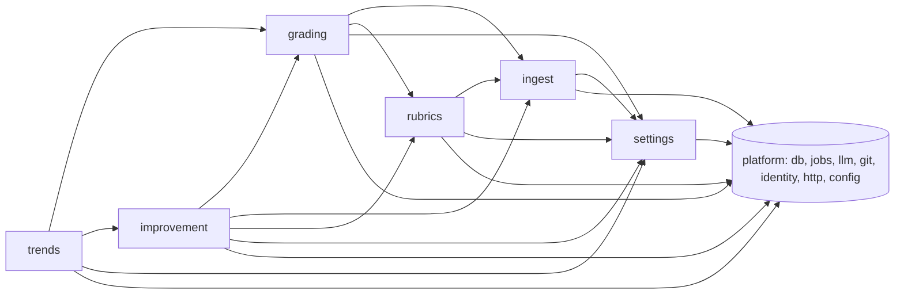

# 0009. Modular monolith with six domain modules and enforced dependency rules

## Status

Accepted (2026-11-08)

## Context

The plan's capabilities split naturally along the loop: collect, grade, propose, prove, configure.
One deployable is decided (ADR-0004).
Inside it, the code must stay maintainable for years by a small team (often one person plus coding agents) and must allow parts to scale out in team mode without rewrites.
Each capability has its own vocabulary and lifecycle: a session is immutable after ingest; a rubric has versions; a proposal has a review lifecycle; trends are a read model.

## Considered options

1. Modular monolith: domain modules with public APIs, private tables, and enforced dependency rules.
2. Layered monolith: technical layers (routes, services, repositories) across all features.
3. A microservice per module.

## Decision table

| Option | Pros | Cons |
|---|---|---|
| Modular monolith | Boundaries match the domain; each module can be read, tested and changed alone. One process, one transaction where needed. A module can later become its own role or service because it already talks through an API and jobs. | Boundaries need tooling to stay enforced. |
| Layered monolith | Familiar, minimal structure early. | Features smear across layers; any service can query any table; boundaries erode, which makes the team-mode split and long-term changes expensive. |
| Microservices | Independent deployment and scaling. | Distributed transactions, network failures, and several deployables for a single-user laptop tool. |

## Evaluation matrix

| Quality attribute | Weight | Modular monolith, enforced boundaries | Layered monolith (controllers/services/repos) | Microservice per module |
|---|---:|---:|---:|---:|
| Simplicity | 20% | 4 | 5 | 1 |
| Maintainability | 25% | 5 | 2 | 3 |
| Testability | 15% | 5 | 3 | 3 |
| Scalability (team mode) | 10% | 4 | 3 | 5 |
| Operability | 15% | 5 | 5 | 1 |
| Distribution / install experience | 15% | 5 | 5 | 1 |
| **Weighted total (max 5.00)** | 100% | **4.70** | 3.75 | 2.20 |

Scores: 1 = poor, 3 = acceptable, 5 = excellent. Weighted total = sum(weight x score) / 100.

## Decision

Modules (each is a folder `src/modules/<name>/` with `index.ts` as its only public entry):

| Module | Owns (tables) | Responsibilities | Public API (examples) |
|---|---|---|---|
| `ingest` | `source`, `ingest_cursor`, `session`, `event`, `signal` | Adapters, watcher handling, redaction, normalisation, signals, flag and sample decisions, outcome linking, payload retention and pinning, team shipping and intake | `listSessions`, `getSession`, `getTrace(id): RedactedTrace`, `importHistory`, `pinSession` |
| `rubrics` | `rubric`, `calibration_label` | Read rubric files from `rubrics/` in the global skills repository, version them, save edits as commits, calibration labels, agreement and gate | `listRubrics`, `getRubric(name, version?)`, `saveRubric`, `isCalibrated(name, version)`, `addLabel` |
| `grading` | `grade` | Judge port and adapters, grading policy, dry runs, reference-set re-grades, pass-rate queries | `gradeSession`, `listGrades`, `passRates(range, bucket)`, `failingGradesSince(t)` |
| `improvement` | `proposal`, `improver_run`, `skill_repo` | Improver port and adapters, clustering, target resolution (global skills repository or a project's `.claude/`), worktrees and branches, proposal lifecycle, accept, edit, reject, PR creation | `runImprover`, `listProposals`, `accept`, `reject`, `editProposal`, `listSkillRepos` |
| `trends` | `change_event` | Change log, before/after comparisons, chart series with merge and version markers | `series(range)`, `listChanges`, `recordChange` |
| `settings` | `setting` | Runtime settings (sources, redaction, judge, sampling, budget, schedule, skills repo, team panel), validation | `get`, `update` |

Platform (shared kernel, no domain logic): `platform/db` (Kysely, dialect helpers, migrations), `platform/jobs` (queue, scheduler), `platform/llm` (Anthropic clients, `llm_call` ledger, budget check), `platform/git` (git CLI wrapper, ADR-0010), `platform/identity` (workspace, user, auth, roles), `platform/http` (Hono app, OpenAPI, auth middleware), `platform/config`.

Dependency rules (checked by `dependency-cruiser` in CI; zero violations allowed):

1. A module imports another module only through its `index.ts`.
2. A module never reads or writes another module's tables.
3. Allowed module dependencies (no cycles): `rubrics → ingest`; `grading → ingest, rubrics`; `improvement → grading, ingest, rubrics`; `trends → grading, improvement`; every module → `settings` and `platform/*`; `ingest` depends on no other domain module.
4. `platform/*` never imports from `modules/*`.
5. HTTP route files are thin: parse with zod, call one module API, map the result.
6. Reactions across modules go through jobs enqueued in the producer's transaction (ADR-0005), for example `ingest` enqueues `grade_session` on session end; `improvement` enqueues `record_change` when a proposal is merged. Jobs are handled by the consumer module.

## Consequences

- Positive: each Phase of the roadmap lands mostly in one module (overview, "Roadmap mapping").
- Positive: in team mode, `ingest` intake and `grading` workers can run as separate roles without code changes.
- Negative: cross-module reads go through APIs, which can mean an extra query instead of a SQL join; acceptable at these volumes, and `passRates` is a purpose-built query owned by `grading`.
- Negative: boundary rules add CI tooling; violations fail the build.

## Revisit triggers

- A module's public API grows beyond 15 functions, or two modules change together in more than half of their commits over a quarter: re-draw the boundary (consult `domain-driven-design-expert`).
- Team mode needs to scale one module independently beyond what roles give.

## Related

- ADR-0004 (roles), ADR-0005 (jobs as module events), overview "Component view".
