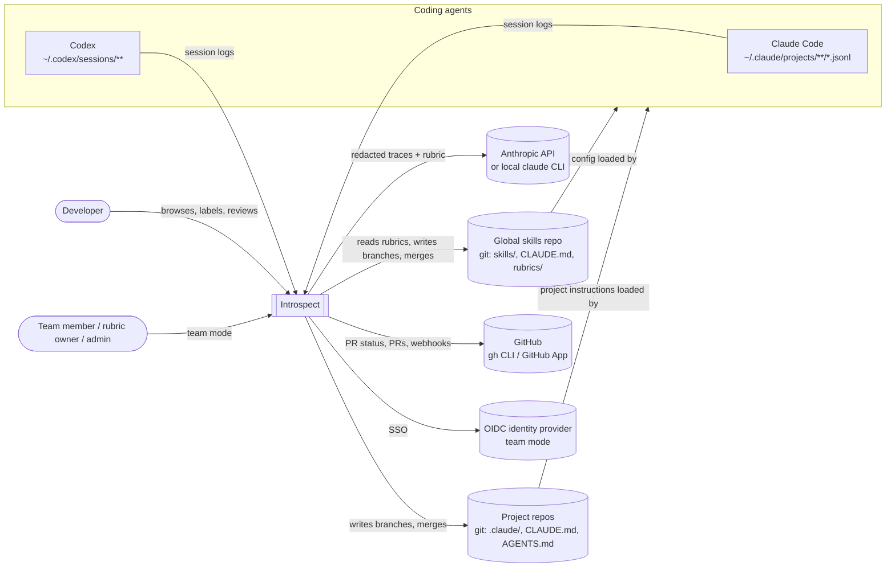
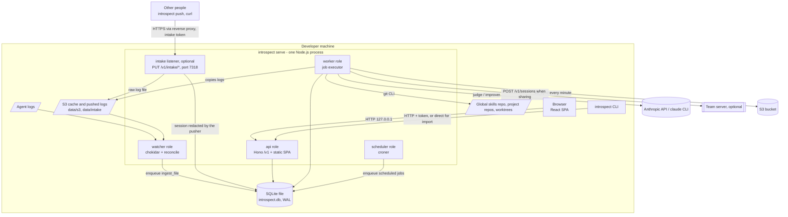
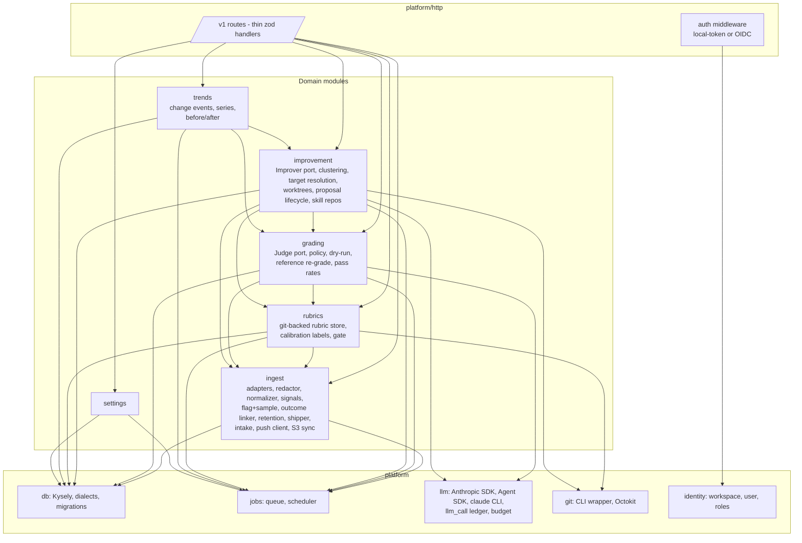
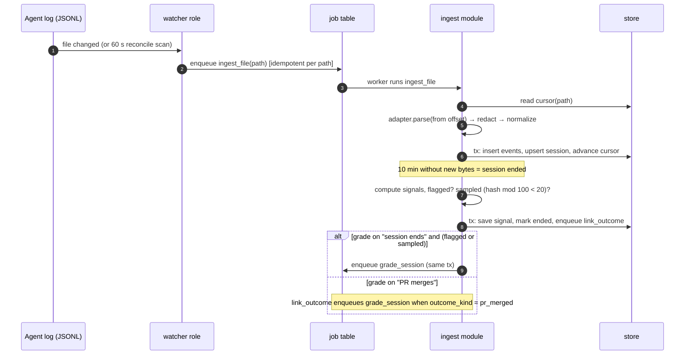
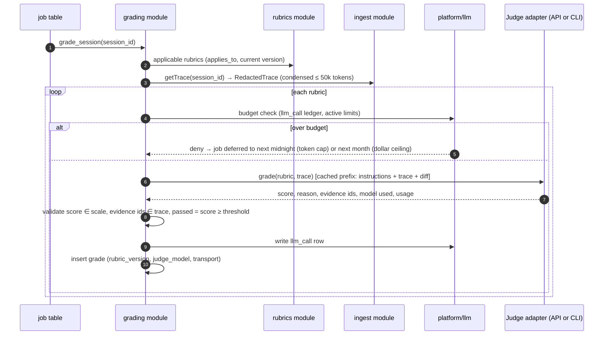
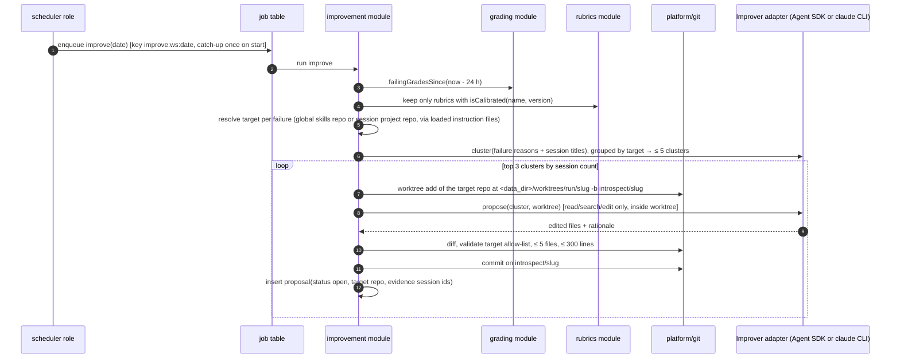
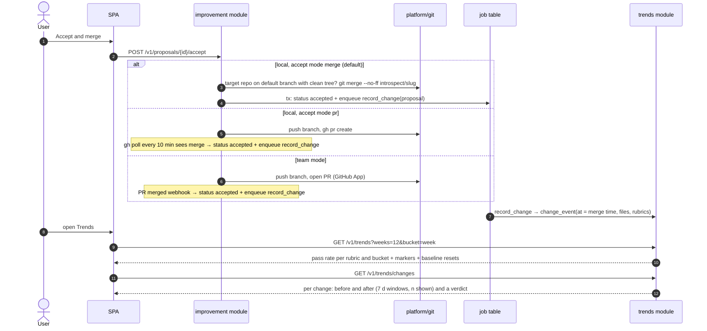
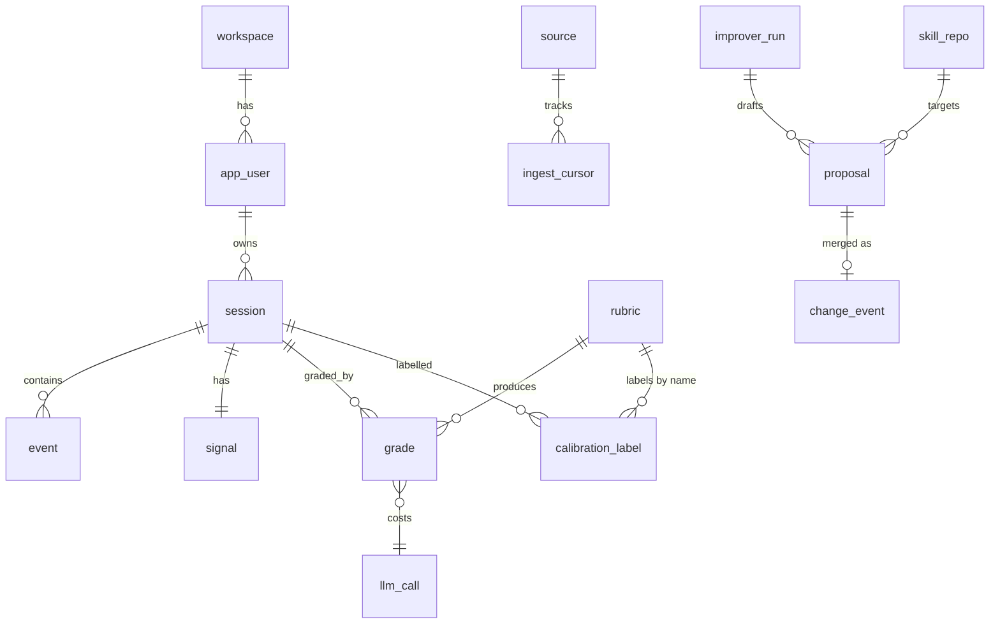
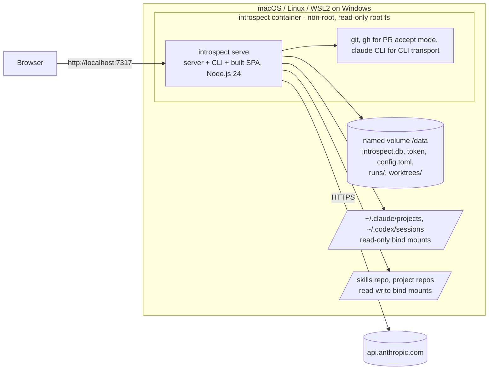
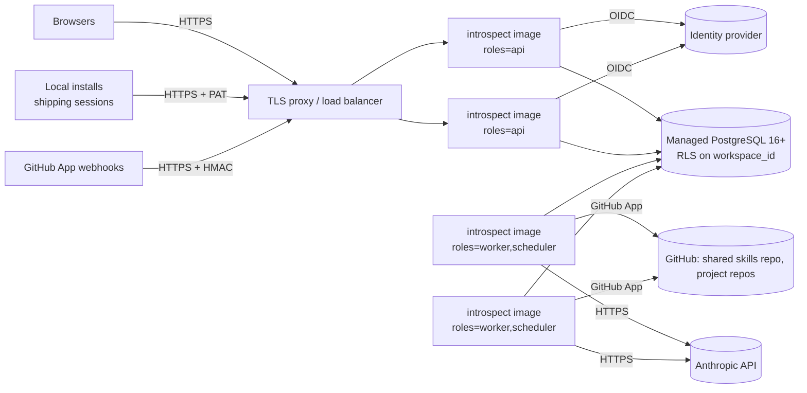

# Architecture overview: Introspect

Status: Accepted, 2026-11-08.
Requirements source: [build plan](../product/build-plan.md) and [wireframes](../mockups/).
Decisions: [ADR index](adr/README.md).
Introspect is the product name; its CLI is `introspect`.

## 1. Summary

Introspect is one TypeScript/Node.js deployable (ADR-0001) with a React SPA (ADR-0002), structured as a modular monolith of six domain modules (ADR-0009).
On a laptop it runs as one process bound to `127.0.0.1` with a single SQLite file (ADR-0003, ADR-0004).
In the cloud the same image runs as API and worker replicas on PostgreSQL, selected by configuration.
Background work runs on a durable job table in the same database (ADR-0005).
Agent logs enter through per-agent adapters and are redacted before anything is stored (ADR-0007).
The LLM judge and improver sit behind domain ports, with an Anthropic API transport and a local `claude` CLI transport (ADR-0006).
Rubrics live in `rubrics/` of the global skills repository; the improver proposes fixes either in that repository or in the `.claude/` instructions of the project a failure came from, works in git worktrees, and a human accepts by local merge or PR (ADR-0010).
All clients, including the UI, use the REST `/v1` API (ADR-0008).

## 2. Quality goals and NFRs

Top three quality goals, in priority order:

1. Privacy and security: no secret leaves the collector unredacted; the local server is unreachable from outside the machine and from foreign web pages.
2. Portability: identical behaviour on macOS, Linux and WSL2 (the supported way to run on Windows) locally, and on any container platform with PostgreSQL in the cloud.
3. Trustworthy measurement: every grade is reproducible in principle (rubric version, judge model and transport recorded), and the judge is gated by calibration.

| ID | Attribute | Target | Verification |
|---|---|---|---|
| NFR-01 | Portability | All E2E tests pass on macOS 14+ arm64, Ubuntu 24.04 x64 and WSL2 Ubuntu 24.04 on Windows 11; native Windows is not supported in v1 | GitHub Actions OS matrix on every PR (WSL2 job on a Windows runner) |
| NFR-02 | Install | From `npm install -g` to the Sessions page in ≤ 2 minutes on a machine with Node.js 24 and git; zero other prerequisites | Scripted fresh-VM install test per release |
| NFR-03 | Ingest latency | p95 ≤ 5 s from a line appended to a watched log to its event in `GET /v1/sessions/{id}/events`; ≤ 65 s in polling mode | E2E test writing to a fixture log |
| NFR-04 | Import throughput | ≥ 2 MB/s of JSONL including redaction on a 2022-class laptop (1 GB history in ≤ 10 minutes) | Benchmark in CI on a 200 MB fixture (performance-profiling) |
| NFR-05 | API latency (local) | `GET /v1/sessions` p95 ≤ 200 ms at 10,000 sessions; `GET /v1/trends` p95 ≤ 300 ms at 200,000 grades | Seeded-data benchmark |
| NFR-06 | UI | Session detail with 5,000 events renders first view in ≤ 1 s; initial JS ≤ 350 KB gzip | Playwright timing; bundle-size check in CI |
| NFR-07 | Durability | `kill -9` of the process at any point loses no ingested event and no queued job; no duplicate grade or proposal after restart | Fault-injection test suite |
| NFR-08 | Redaction | 0 of ≥ 200 seeded secrets from a test corpus reach the database, a judge request, or a shipped payload | Corpus test on every PR (security-audit) |
| NFR-09 | Local exposure | Server refuses non-loopback binds in local mode; requests with a foreign `Host` or `Origin` get 403 | Integration tests incl. DNS-rebinding case |
| NFR-10 | Judge trust | A rubric version feeds the improver only with ≥ 8/10 agreement on its calibration set; reference set of 20 sessions re-graded after any judge or rubric change | Enforced in code; calibration table in the UI |
| NFR-11 | Cost control | LLM usage never exceeds the active limits (tokens per day and/or estimated dollars per month, user-selectable) by more than one in-flight call; default 1,000,000 tokens per day, no dollar ceiling | Ledger test per budget mode; UI shows today's tokens and this month's spend |
| NFR-12 | Team scale | 50 users, 2,500 sessions per day, API p95 ≤ 300 ms at 20 requests per second on 2 API replicas | Load test before Phase 5 release |
| NFR-13 | Team availability | 99.5 % monthly for the API; RPO 24 h, RTO 4 h | Uptime check; restore drill per quarter |
| NFR-14 | Maintainability | 0 module-boundary violations, 0 type errors, 0 lint errors, 0 known flaky tests on main | dependency-cruiser, `tsc`, ESLint in CI; flaky tests are fixed or quarantined within 2 working days |
| NFR-15 | Observability | Structured JSON logs (pino) with job ID and session ID; `/healthz` and `/readyz`; team mode exposes Prometheus `/metrics` (job queue depth, job failures, LLM tokens, API latency) | Ops checklist before Phase 5 |
| NFR-16 | Retention | Redacted event payloads purged within 24 h after they turn 90 days old (configurable, minimum 7); pinned sessions (calibration and reference sets) never purged; sessions, signals, grades and trends kept forever | Purge-job test with a clock fixture, including pinned sessions |

## 3. Context view

Only redacted data crosses the Introspect boundary towards Anthropic and, in team mode, towards the team server.
One exception: in raw intake mode other people send unredacted logs to the server, which redacts them on ingest (ADR-0012).

## 4. Container view

The intake listener (ADR-0012) is a second port in the same process, started when `INTROSPECT_INTAKE_PORT` is set.
It serves only intake routes with per-person tokens.
Raw uploads become files under `data/intake/<person>/<agent>/` and ordinary sources; redacted sessions are upserted directly.
S3 sources are mirrored by the `s3_sync` job into `data/s3/<source id>`, and then they are ordinary folder sources.
Contract: `docs/api/intake-openapi.json`.

Team mode replaces the SQLite file with PostgreSQL, disables the watcher on the server, and adds OIDC, GitHub App webhooks, and several replicas (section 8).

## 5. Component view

### Module boundaries and dependency rules

The full rules are in ADR-0009; in short:

1. Modules expose only `index.ts`; each module owns its tables, and no other module touches them.
2. Allowed dependencies: `rubrics → ingest`; `grading → ingest, rubrics`; `improvement → grading, ingest, rubrics`; `trends → grading, improvement`; all → `settings`, `platform/*`. No cycles.
3. `platform/*` never imports modules.
4. Cross-module reactions are jobs enqueued in the producer's transaction.
5. LLM adapters accept only branded `RedactedTrace` / `RedactedText` values, constructible only by `ingest`.

## 6. Runtime flows

### 6.1 Ingest → signals → grading trigger

### 6.2 Grade

Triggers: a `grade_sweep` schedule (every 5 minutes) queues one `grade_session` job per ended session in the last 7 days that the policy selects (flagged or in the 20 % sample, or all with sampling `every`; a merged PR with `schedule.grade = pr_merge`) and per rubric whose `applies_to` fits and that has no grade yet; `grade_batch` jobs come from the API (re-grade, "Grade selected"); `introspect grade` runs the same code in the foreground.
The judge sees a deterministic condensed trace with events labelled `e<seq>`; labels map back to event ids.

### 6.3 Nightly improve

### 6.4 Accept → change event → trend

**What counts.**
A pass rate counts the newest `ok` grade of each session and rubric name, grouped by the session's start.
Stale, invalid and refused grades never count.
Buckets are days or ISO weeks (Monday start) in the server's time zone (env `TZ`); empty buckets stay in the series with a null rate.
The database does the work: one query with a window function returns one row per rubric and quarter-hour, and the server only maps those rows to buckets.
Quarter-hour is the grain because every real time zone's offset is a multiple of it.
The query starts at the sessions of the range (`session_workspace_started`) and reaches their grades through the unique `(session_id, rubric_version, judge_model)` index; SQLite has no statistics, so the SQL fixes that join order.
NFR-05 is measured with 200,000 grades over one year on both dialects (`trends.nfr.test.ts`, `trends.nfr.pg.test.ts`, run by `make test-pg` because a timing test must not share the machine with parallel tests): p95 about 110 ms (limit 300 ms) for the default 12-week series.
The 26-week requests (about 100,000 grades; by week or by day) measure 255 to 300 ms and are guarded at 450 ms.
If the volume outgrows this, the upgrade path is a rollup table of closed days.

**Where change events come from.**
`change_event` rows have three sources.
An accepted proposal writes its event in the accept transaction (kind `proposal_merged`).
A scan job (`trends_scan`, every 15 minutes and once at start) finds the rest, and every event it writes has a unique `ref`, so a repeated or interrupted scan never doubles one:

- *Manual edits.*
  Per enabled repository the scan compares the tip of the default branch with `skill_repo.last_seen_sha`.
  Each new first-parent commit that touches a file in the repository's allow-list becomes a `manual_edit` event with those files.
  Introspect's own commits are skipped: the merge commit of an accepted proposal (subject `Merge proposal: `, or its sha), the head of any proposal that has a branch or pull request, and any merge whose parent is such a head.
  Any status counts: GitHub merges a pull request before the poller marks the proposal accepted, and that merge must not be read as a person's edit.
  If a `manual_edit` for that commit was recorded anyway, accepting the proposal deletes it, so the change has exactly one event (`proposal_merged`).
  The first scan only remembers the tip.
  Enabling a repository again resets its tip (commits made while it was off are not replayed); while it is off the tip is left alone.
  A scan looks at 500 commits per repository at most (oldest first, the rest in the next scan).
  A commit it cannot read is skipped, and a history rewrite (the old tip is no ancestor of the new one) only moves the tip.
  Both leave a `skill_repo.scan_warning` ("History rewritten on ...; edits between X and Y are not tracked"), which `introspect doctor` shows as `change-scan` until a later scan that finds new commits ends without a problem.
  The rubrics of the event are those of proposals made in the last 30 days for one of the same files; else none.
  A pull request squash-merged on GitHub looks like a manual edit.
- *Rubric changes.*
  A second or later `rubric` row for the same name is a `rubric_changed` event, and a baseline reset for that rubric.
- *Judge changes.*
  The scan keeps a watermark, the setting row `trends.last_judge_model` (`{model, at, seq}`): the model the judge used last and since when.
  A switch is found when the effective model differs from it, by the settings hook (a `PATCH /v1/settings` that touches a `judge.*` key; the event time is that moment) and, as a fallback, by the scan (the time is that of the first grade by the new model after the watermark, else now).
  Each switch writes a `judge_changed` event (a baseline reset for every rubric) with the ref `judge-<seq>`, so A to B to A to B are three events, and its re-grade job is keyed by that ref, not by the model names.
  Without a watermark it starts from the model of the newest grade.

A rubric change and a judge change re-grade the reference set (below) once, through a keyed job.
A rubric change re-grades only that rubric; a judge change re-grades all.
Everything one scan finds goes into one job (the union of the rubrics, or all of them).
The first scan after an upgrade (no `trends.last_scan_at` yet) records the rubric versions it finds but queues no re-grade: they are history.

**Before and after.**
Per change the log compares the graded sessions that started in the `trends.window_days` (default 7) before the change with those that started in the same span after it, separately for each rubric the change was meant to move (every current rubric when none is known).
The unit is the distinct session: a session counts once per rubric (its newest `ok` grade) and rubrics are never pooled.
Reference re-grades (`grade.origin = 'reference'`) are not counted anywhere, so re-judging old sessions with today's rubric and judge cannot rewrite past buckets or windows.
A baseline reset of a rubric inside a window cuts that rubric's side of the window at the reset, so two yardsticks are never compared.
A rubric change has no "before"; its verdict is `too_early`.
A rubric needs `trends.min_graded` (default 10) distinct sessions on BOTH sides; with fewer it is `too_early` and has no p-value.
For the others the p-value is two-sided: Fisher's exact test when either side has fewer than 30 sessions, else the pooled z-test.
The Holm step-down correction at 10% runs over the rubrics that passed the gate: the smallest p-value must be at most 0.10 / m, the next 0.10 / (m - 1), and so on.
A rubric that passes is `improved` or `worse` by the direction of its rates, the others are `no_change`.
The change is `worse` if any rubric is worse, else `improved` if any improved, else `no_change`; it is `too_early` when no rubric passed the gate.
`perRubric` carries every rubric's before, after, verdict (after Holm) and p-value; the top-level `before` and `after` are those of the rubric with the smallest p-value.
The ceiling is power: with 10 sessions on each side only a gap of 40 to 50 points is significant (6/10 against 10/10, 3/10 against 8/10; 7/10 against 10/10 is `no_change`), and each further rubric makes Holm stricter, so small real gains read as `no_change` until more sessions are graded.

**Reference set.**
Up to 20 sessions are marked as reference (`POST` and `DELETE /v1/sessions/{id}/reference`); members are pinned and a removal keeps the pin.
`POST /v1/trends/reference-regrade` queues a forced re-grade of all members with every current rubric (a normal `grade_batch` job whose grades carry `origin = reference`).
A reference grade never replaces a standard grade of the same session, rubric version and judge model, and a standard grade replaces a reference one.
The 20-member cap is enforced under a row lock on Postgres (`SELECT ... FOR UPDATE` on the workspace), so two concurrent adds cannot both take the last place.
The same job is queued once, by key, after a rubric version change or a judge model change, and not at all while the set is empty.

## 7. Data model

Refined from the plan's seven tables; additions are marked with *.
All IDs are UUIDs (sessions UUIDv5, others UUIDv7); every table carries `workspace_id`; user-owned rows carry `user_id` (ADR-0003).

| Table | Owner | Key fields | Notes |
|---|---|---|---|
| `workspace`* | identity | id, name | One fixed row locally |
| `app_user`* | identity | id, workspace_id, display_name, email, role, share_sessions | One fixed row locally; roles member / rubric_owner / admin |
| `source`* | ingest | id, user_id, agent, path, mode (watch / poll), enabled | Settings "Sources" |
| `ingest_cursor`* | ingest | source_id, file_path, file_fingerprint, byte_offset, size, mtime, session_id | Makes ingest resumable and idempotent |
| `session` | ingest | id, user_id, agent, native_id, title*, repo, repo_root*, branch, cwd, started_at, ended_at*, duration_s, tokens_in/out/cache_read/cache_write (`tokens_in` excludes cache), usage_tail, cost, model*, status*, outcome_kind*, outcome_ref, adapter_version*, redaction_version*, flagged*, sampled*, in_reference_set*, pinned*, ingest_warnings* | `outcome_kind`: none / commit / pr_open / pr_merged; `pinned` sessions are never purged |
| `event` | ingest | id, session_id, seq, ts*, kind, name, input, output, is_error, ms, truncated*, payload_purged_at* | `input`/`output` set to NULL after 90 days unless the session is pinned. Kinds: user, assistant, tool_call (call + result), file_op, mcp, skill, system, unknown. Unique (session_id, seq) |
| `signal` | ingest | session_id, failed_tool_calls, retries, repeated_commands, files_touched, tests_run, signal_version* | Computed at session end |
| `rubric` | rubrics | id, name, version (blob SHA), ordinal*, commit_sha*, scale, pass_threshold, target_pass_rate*, applies_to*, body_md | Unique (workspace_id, name, version) |
| `calibration_label`* | rubrics | id, rubric_name, session_id, user_id, label (pass / fail), note | Rubrics "You" column; "Judge was wrong" creates one |
| `grade` | grading | id, session_id, rubric_id, rubric_version, score, passed, reason, evidence_event_ids, judge_model, transport*, status* (ok / refused / invalid), llm_call_id*, graded_at | Unique (session_id, rubric_version, judge_model); latest per rubric is current; `origin`* (standard / reference): reference re-grades are not counted in trends |
| `proposal` | improvement | id, run_id*, title*, target_repo_id*, target_path, branch*, base_sha*, head_sha*, diff, rationale, evidence_session_ids, rubric_names*, status, decided_by*, decided_at*, decision_note*, pr_url*, cluster_summary*, merge_commit* | Status: open / accepted / rejected / conflict / superseded / failed (diff refused) |
| `skill_repo`* | improvement | id, kind (global / project), path, remote_url, default_branch, allow_list, accept_mode (override), enabled, last_seen_sha*, scan_warning* | One global row from Settings, project rows registered on first target |
| `improver_run`* | improvement | id, started_at, finished_at, status, clusters, proposals_created, summary*, error* | Settings shows last and next run; `summary` lists clusters, excluded untrusted rubrics and skipped sessions |
| `change_event` | trends | id, at, kind* (proposal_merged / manual_edit / judge_changed / rubric_changed), proposal_id?, repo_id*, description, files, rubric_names*, ref* | Trend markers. Unique (workspace_id, kind, ref); `ref` is null for proposals. `skill_repo.last_seen_sha` is the scan's watermark |
| `llm_call`* | platform/llm | id, at, purpose (grade / dry_run / cluster / improve), model, transport, tokens_in, cache_read_tokens, tokens_out, cost_estimate, ref_id | Budget ledger |
| `job`* | platform/jobs | see ADR-0005 | Durable queue |
| `schedule_state`* | platform/jobs | name, last_fired_period | Catch-up after sleep |
| `setting`* | settings | workspace_id, key, value (json) | Runtime settings edited in the UI |
| `auth_session`*, `api_token`* | identity | team mode only; tokens stored hashed | Created by the same migrations, empty locally |

Bootstrap configuration (mode, database URL, bind address, auth issuer) comes from environment and `config.toml`; everything a user changes in the Settings screen lives in `setting`, so local and team mode share one settings model.
Storage estimate: payloads about 25 MB per user per week (64 KiB cap per field), so with 90-day retention the local store levels off at about 0.3–0.5 GB, plus a few MB per year of metadata, signals and grades.

## 8. Deployment views

### 8.1 Local

Docker Compose is the primary local runtime (ADR-0011).
The npm package remains supported for users without Docker.

- One container, one process: `introspect serve` with roles `api,watcher,worker,scheduler`.
- The container runs as the host UID and GID, so files in bind mounts are never owned by root.
- The watcher polls by default, because inotify is unreliable on WSL2 and Docker Desktop bind mounts.
- The port is published on `127.0.0.1` only; nothing listens on a non-loopback host interface.
  The intake port 7318 is published on `${INTROSPECT_INTAKE_BIND:-127.0.0.1}`; exposing it needs TLS in front (ADR-0012).
- Credentials: the API key lives in the data volume (mode 0600); the CLI transport mounts `~/.claude` read-only, the one weaker isolation point (ADR-0011).
- Development uses the same image lineage: `compose.dev.yaml` (source bind-mounted, Postgres 16) driven by the Makefile, also as a devcontainer.
- Without Docker: install the npm package and run `introspect serve` on the host; inside WSL, sources under `/mnt/c/...` are polled.

### 8.2 Cloud (team mode)

- Minimum: one container with all server roles and one managed Postgres instance.
- The scheduler is safe on several replicas (advisory lock); workers scale horizontally (`SKIP LOCKED`).
- The CLI transport (`claude -p`) is not used on the server; team judging uses the API transport with a workspace credential.
- Hosting platform is decided at Phase 5 with `devops-expert`; the image stays host-agnostic.
- Data residency: EU-only is assumed; containers, PostgreSQL and backups run in an EU region, and the judge data flow to Anthropic is checked at Phase 5 (ADR-0004).

## 9. Screen to API mapping

| Screen | Element (mockup) | Endpoint | Module |
|---|---|---|---|
| Sessions | Header counts, pass-rate cards vs target | `GET /v1/trends/summary?days=7` | trends (via grading `passRates`) |
| Sessions | Search, Agent and Result filters, table with tool errors and rubric chips | `GET /v1/sessions?q=&agent=&result=failed_any|all|not_graded&cursor=` | ingest + grading (current grades joined via API) |
| Sessions | Import history | `POST /v1/imports` → 202 job | ingest |
| Sessions | Grade selected | `POST /v1/grades/batch {sessionIds, rubrics?, force?}` → 202 job (status `deferred` with the reason in `error` when over budget) | grading |
| Session detail | Header (agent, repo, branch, duration, tokens, PR) and grades `[{rubric, rubricVersion, rubricSha, score, passed, reason, evidenceEventIds, judgeModel, transport, gradedAt, status, trusted}]` | `GET /v1/sessions/{id}` | ingest + grading |
| Session detail | Trace timeline, All / Errors / Evidence only (union of the evidence ids of the newest grades) | `GET /v1/sessions/{id}/events?filter=all|errors|evidence&cursor=` | ingest (+ evidence IDs from grading) |
| Session detail | Open raw JSONL (local only) | `GET /v1/sessions/{id}/raw` | ingest |
| Session detail | Grades with reason and evidence | `GET /v1/grades?session_id=` (same objects as above) | grading |
| Session detail | Re-grade | `POST /v1/sessions/{id}/grade` → 202 job (replaces the grade of the same rubric version and judge model) | grading |
| Session detail | Judge was wrong / Add to calibration set | `POST` or `PUT /v1/rubrics/{name}/labels {sessionId, passed, score?, note?}` → 204; pins the session | grading |
| Rubrics | Rubric list with gate state; editor, threshold, applies to, target, commit history, calibration rows | `GET /v1/rubrics` → `RubricSummary[]`, `GET /v1/rubrics/{name}` → `RubricDetail` | rubrics (+ grading) |
| Rubrics | Save as vN (commit) and + New rubric | `PUT /v1/rubrics/{name} {body, passThreshold?, target?, message?}`; `body` is the whole file or only the text below the frontmatter; a new name creates the file | rubrics |
| Rubrics | Dry-run on up to 20 sessions, saved rubric or unsaved draft | `POST /v1/rubrics/{name}/dry-run {sessionIds, body?, passThreshold?}` → 200 `{verdicts, skipped, usage}` (synchronous; 429 problem when over budget) | grading (nothing persisted as grades) |
| Rubrics | Calibration table, n/10, gate | `GET /v1/rubrics/{name}/calibration` | grading |
| Settings | Test the judge transport (a tiny real request) | `POST /v1/judge/test {transport, apiKey?}` | grading |
| Settings | Tokens today, spend this month against the active limits | `GET /v1/budget` | grading |
| Proposals | Nav badge, Open / Accepted / Rejected tabs, list (`total` of `?status=open` is the badge) | `GET /v1/proposals?status=` | improvement |
| Settings | Last runs, next run, run now | `GET /v1/improver/runs`, `GET /v1/improver/schedule`, `POST /v1/improver/runs` | improvement |
| Proposals | Detail: branch, target repo and file, why, evidence, diff | `GET /v1/proposals/{id}` | improvement |
| Proposals | Accept and merge / Edit first / Reject with reason | `POST /v1/proposals/{id}/accept`, `PATCH /v1/proposals/{id}`, `POST /v1/proposals/{id}/reject` | improvement |
| Trends | Range, series per day or week, markers, baseline resets | `GET /v1/trends?weeks=4|12|26&bucket=week|day` | trends |
| Trends | Change log with before → after and a verdict | `GET /v1/trends/changes` | trends |
| Trends | Reference set: members, add, remove, re-grade | `GET /v1/trends/reference`, `POST` and `DELETE /v1/sessions/{id}/reference`, `POST /v1/trends/reference-regrade` (202 Job) | trends, grading |
| Settings | Sources, redaction, retention days, judge "Runs via" (API key default or claude CLI), sampling, budget mode and limits, schedule, accept mode | `GET /v1/settings`, `PATCH /v1/settings`, `GET /v1/sources`, `POST /v1/sources` | settings, ingest |
| Settings | Global skills repo, registered project repos (enable, accept-mode override) | `GET /v1/skill-repos`, `GET /v1/skill-repos/detected`, `PUT /v1/skill-repos/global`, `POST /v1/skill-repos/projects`, `POST /v1/skill-repos/global/init`, `PATCH /v1/skill-repos/{id}` | improvement |
| Settings | Last / next improver run, dead jobs | `GET /v1/jobs?status=dead` | platform/jobs |
| Settings | Team mode: server URL, share toggle, Connect with SSO | `PATCH /v1/settings` (team.*), device flow against the team server | settings, identity |
| (team) | Shipper intake | `POST /v1/sessions` (idempotent upsert) | ingest |
| (team) | GitHub App webhook | `POST /v1/webhooks/github` | ingest (outcome), improvement (PR merged) |

The plan's four contract roots (`/v1/sessions`, `/v1/grades`, `/v1/proposals`, `/v1/trends`) are kept; the other resources are additions required by the screens.

## 10. Cross-cutting concepts

- Privacy and security: redaction before persistence (ADR-0007); branded redacted types at the LLM boundary (ADR-0006); loopback + Host/Origin checks + per-install token locally, OIDC + RLS in team mode (ADR-0008). Team mode processes employee activity data; trends aggregate by rubric, workspace and repository, and there is no per-person ranking endpoint.
- Self-ingest guard: Introspect's own `claude` runs execute under `<data_dir>/runs/` and are excluded from ingest.
- Configuration: bootstrap in env and `config.toml`; runtime settings in the database; one zod schema validates both.
- Errors: RFC 9457 problem details at the API; dead jobs visible in Settings with their last error.
- Testing: unit tests per module with fake Judge and Improver; repository tests on SQLite and Postgres; E2E with Playwright against a real `introspect serve` on fixture logs, on all three OS targets; opt-in contract tests against real models and the installed `claude` CLI.

## 11. Risks and how the architecture addresses them

| Risk (plan) | Architectural response |
|---|---|
| Secrets in traces | Redact in the collector before any write; fail closed; seeded-secret corpus test (NFR-08); server re-redacts on intake; HMAC placeholders keep correlation |
| Judge cost | Flagged + 20 % stable sample; trace condensation to ≤ 50k tokens; prompt caching across rubrics; token and/or monthly dollar limits enforced from the `llm_call` ledger with deferral; Sonnet 5.5 as default judge |
| Judge drift | `judge_model`, transport and `rubric_version` (blob SHA) on every grade; reference set of 20 re-graded on change; baseline-reset markers on trends |
| Rubric overfitting | Improver cannot edit `rubrics/`; calibration gate per rubric version; human accept required; diff size limits |
| Team trust | Aggregates by rubric/workspace/repo only; per-user share opt-out enforced at shipper and server; RLS |
| Agent log formats change (added) | Versioned adapters with fixtures per agent version; `unknown` events and ingest-warning counter instead of crashes |
| Laptop asleep at schedule time (added) | Durable schedule state with single catch-up on start; last/next run visible |
| Damage to the user's skills or project repos (added) | Worktrees for improver; allow-lists limited to skills, commands, agents, `CLAUDE.md` and `AGENTS.md` (never source code, hooks, settings or scripts unless a repository sets `allowExecutable`); merges only on explicit accept with a clean tree on the default branch, or via PR; rubric saves commit only their own path |
| Fix lands in the wrong place (added) | Target resolution from loaded instruction files' real paths; one target repo per cluster; target shown in the inbox before accept |
| Dual-dialect drift (added) | One Kysely migration set; repository tests on SQLite and Postgres in CI from Phase 1 |
| CLI transport instability (added) | Pinned CLI version range with contract tests; API transport as fallback |

## 12. Roadmap mapping

| Phase (plan) | Architecture delivered | Modules / platform | Gate evidence |
|---|---|---|---|
| 1 Collect (week 1) | Package skeleton, config, Kysely + migrations on both dialects, job queue, watcher, Hono `/v1` + SPA shell, local-token auth, Claude Code and Codex adapters, redaction, signals, Sessions + Session detail (trace only), Settings sources/redaction/retention, payload purge job | platform/*, ingest, settings | A week of sessions browsable; NFR-03, NFR-07, NFR-08 green |
| 2 Grade (weeks 2–3) | Rubric store over git, 4 rubric files, Judge port with API and CLI adapters, grading policy, `llm_call` ledger + budget modes, `introspect grade` CLI, grades on Session detail, calibration labels, Rubrics screen with dry-run | rubrics, grading, platform/llm, platform/git | Judge agrees 8/10 per rubric (NFR-10) |
| 3 Improve (week 4) | Improver port + adapters, target resolution (global and project repos), clustering, worktrees, diff validation, proposals inbox, accept / edit / reject with merge and PR modes, scheduler with catch-up | improvement, platform/jobs scheduler | First proposal accepted |
| 4 Prove (week 5) | Change events (proposal and manual edits across registered repos), trend series with markers and baseline resets, before/after, reference-set re-grade | trends, grading | One fix visibly moves a score |
| 5 Team (later) | OIDC + PATs + roles, RLS, OCI image, shipper (`POST /v1/sessions`), GitHub App (webhooks, PRs), privacy opt-out, workspace budget, Prometheus metrics | identity, ingest intake, improvement PR path | Load and security review (NFR-12, NFR-13) |

Running the Postgres repository tests from Phase 1 is the only Phase-5 cost pulled forward; it keeps the team seam real.

## 13. Resolved decisions

The user answered the open questions on 2026-11-08; all ADRs are Accepted with these answers applied.

| # | Question | Answer | Where reflected |
|---|---|---|---|
| 1 | Judge and improver transport | Both supported and user-selectable in Settings ("Runs via"); default Anthropic API key. The CLI transport (`claude -p` on the user's subscription) is local mode only | ADR-0006 (transport selection), section 9 |
| 2 | Where skills live | Both a global skills repository and per-project `.claude/` folders. The improver targets the repository and file the failure came from | ADR-0010 (skill repositories, target resolution), ADR-0007 (`repo_root`, instruction file paths), ADR-0009 (`skill_repo` owned by improvement), sections 6.3 and 7 |
| 3 | Where rubrics live | `rubrics/` inside the global skills repository. The improver never edits `rubrics/` | ADR-0010 (rubrics), ADR-0009 |
| 4 | Accept behaviour | Both local `git merge --no-ff` (clean tree on the default branch required) and PR via `gh`, configurable globally with a per-repository override. Default: local merge | ADR-0010 (accept), sections 6.4 and 9 |
| 5 | Budget | User-selectable: tokens per day, tokens per day plus monthly dollar ceiling, or monthly dollar ceiling only. Default 1,000,000 tokens per day, no dollar ceiling | ADR-0005 (budget), ADR-0006 (ledger), NFR-11 |
| 6 | Retention | Redacted event payloads deleted after 90 days (configurable). Sessions, signals, grades and trends kept forever. Calibration-set and reference-set sessions pinned and never purged | ADR-0003 (retention, vacuum), ADR-0007 (pinning), NFR-16, section 7 |
| 7 | Team hosting | Decided at Phase 5. EU-only data residency assumed. The container image stays host-agnostic | ADR-0004 (cloud), section 8.2 |
| 8 | Windows | WSL2 is enough; native Windows is not supported in v1 | ADR-0001, ADR-0004, NFR-01, section 8.1 |
| 9 | Name | Product "Introspect", CLI `introspect` (data directory `introspect`, database `introspect.db`, branches `introspect/<slug>`, image `introspect`) | All architecture documents |

Remaining items to settle at Phase 5 (not blocking v1): the hosting platform, whether Anthropic's processing options meet the EU-only requirement, and, for use in a German company, works-council agreement (§ 87 (1) no. 6 BetrVG) and a data-protection review.
