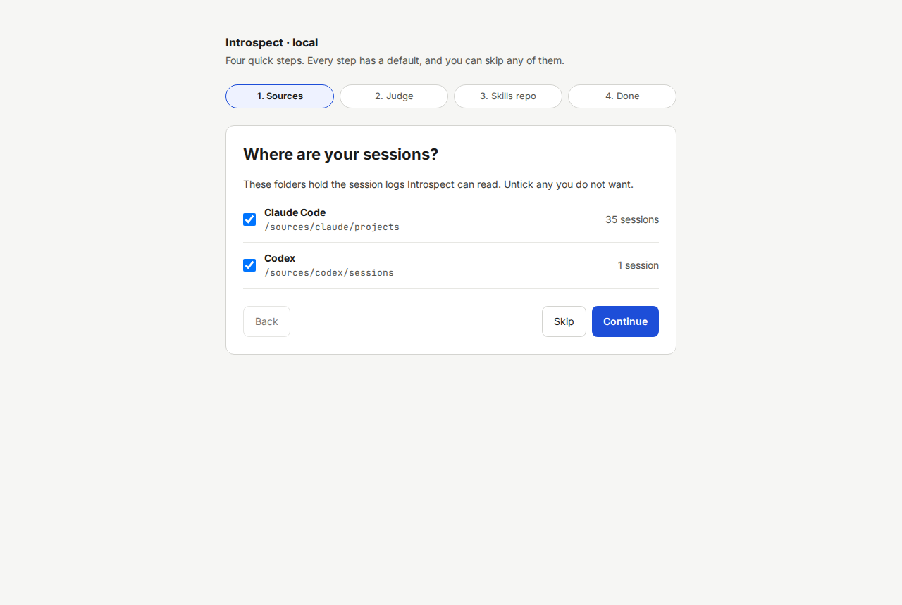

# Quick start with Docker

This procedure takes about five minutes, plus the time for the first image build.
At the end you see your sessions in Introspect.

Before you start, check the [requirements](03-requirements.md) and read the [safety and privacy notes](02-safety-and-privacy.md).

## Procedure

1. Clone the repository and change into it.

   ```sh
   git clone https://github.com/floriankraemer/ai-introspection.git ai-introspection
   cd ai-introspection
   ```

   You are now in the project folder.

2. Optional: copy the example settings file.

   ```sh
   cp .env.example .env
   ```

   A file named `.env` exists.
   Skip this step to use the defaults.
   Open `.env` in an editor if you want to set one of these now:

   - `GIT_AUTHOR_NAME` and `GIT_AUTHOR_EMAIL`, so commits made by Introspect carry your name.
     Without them, commits show the name "Introspect".
   - `INTROSPECT_SKILLS_REPO`, the path of your existing skills repo.
   - `INTROSPECT_PROJECTS_DIR`, the folder with your project repos.

   See the [configuration reference](15-configuration-reference.md) for every variable.

   > **NOTICE: Do not set `INTROSPECT_SKILLS_REPO` to `~/.claude`.**
   > That folder holds your Claude credentials and transcripts, and Introspect mounts the skills repo read-write.

3. Start Introspect.

   ```sh
   make up
   ```

   Docker builds the image, which takes a few minutes the first time.
   The command ends without an error after the container reports as healthy.
   `make up` also creates the mounted folders `~/.claude/projects`, `~/.codex/sessions`, `~/.introspect/skills` and `~/.introspect/projects` as your user if they do not exist.

4. Print the sign-in link.

   ```sh
   make open
   ```

   The terminal prints a link such as `http://127.0.0.1:7317/auth#<token>`.

5. Open the link in your browser.

   The browser signs in, removes the token from the address bar and shows the setup wizard with the heading **Where are your sessions?**.

   

6. Click **Continue** in each step.
   Details for each step are in the [setup wizard walkthrough](05-setup-wizard.md).

   After the last step, Introspect imports your sessions and opens the Sessions screen.

7. Check that your sessions appear.

   The page shows a table of sessions.
   The subtitle shows how many sessions Introspect collected.

If something does not work, run `make doctor`.
It prints one line per check and one fix line for each problem.
See [Troubleshooting](16-troubleshooting.md).

## Try it without a model

> **NOTICE: This is for evaluation only.**
> The fake judge and the fake improver do not read your sessions and produce placeholder results.

To try Introspect without Claude access and without spending tokens, add these lines to `.env` before `make up`:

```sh
INTROSPECT_JUDGE=fake
INTROSPECT_IMPROVER=fake
```

The Health check in [Settings](11-screen-settings.md) shows a warning while a fake is active.
Remove both lines and restart (`make up`) to use real grading.

## What you can do next

- Grade a few sessions: [Sessions](06-screen-sessions.md).
- Check or write rubrics: [Writing and calibrating rubrics](12-writing-and-calibrating-rubrics.md).

## Starting, stopping and updating

| Task | Command |
|---|---|
| Stop Introspect. Your data stays. | `make down` |
| Start it again | `make up` |
| Update to a newer version | `git pull`, then `make up` |
| Print a new sign-in link | `make open` |

Introspect restarts by itself when Docker restarts, unless you ran `make down`.
