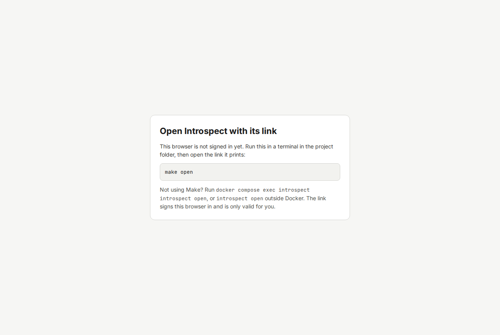
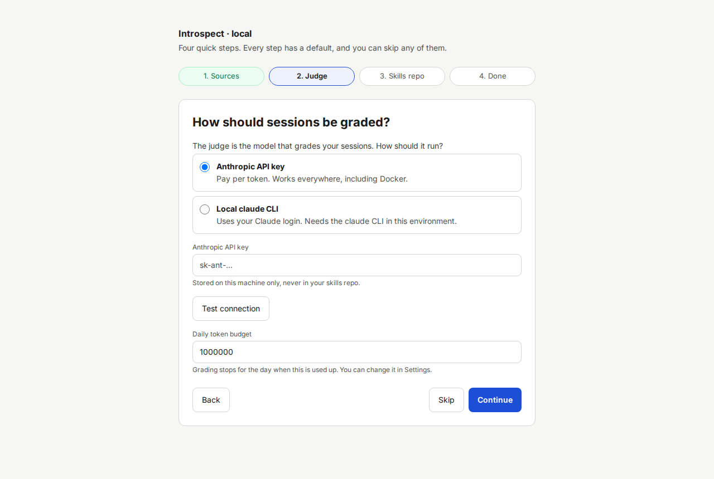
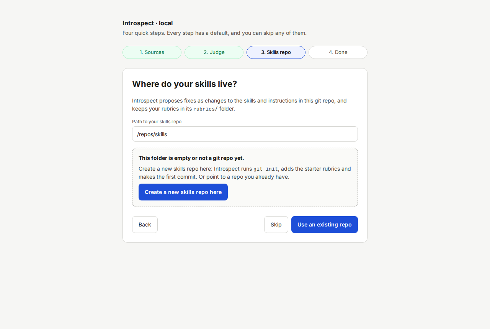
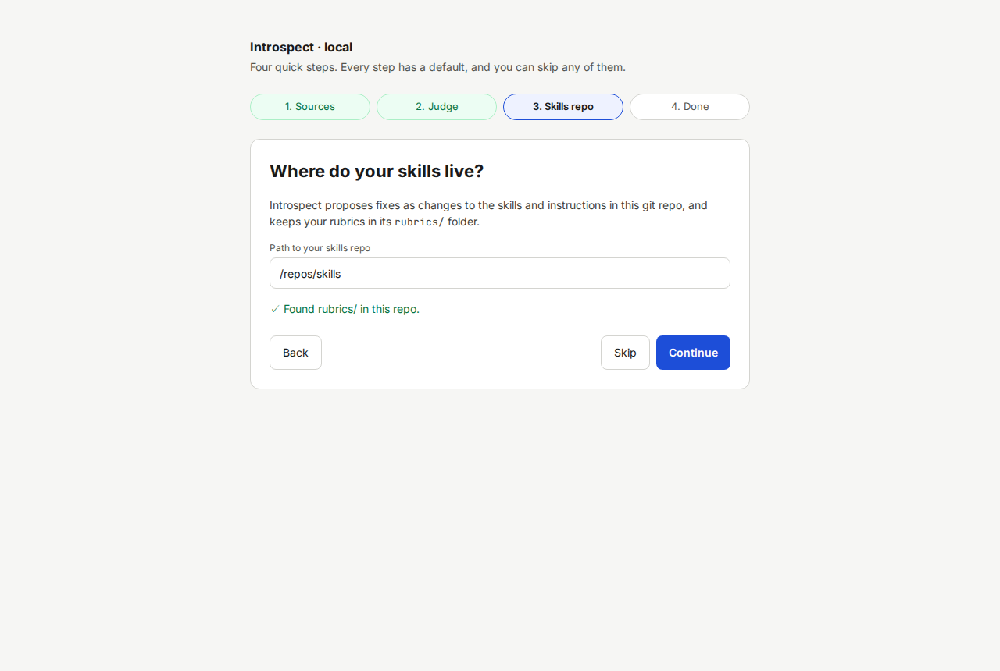
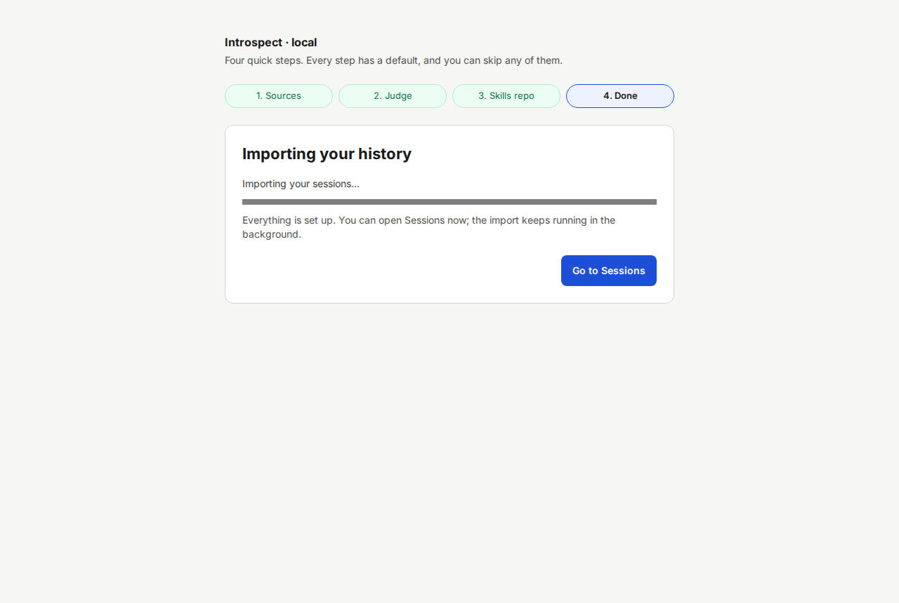

# Setup wizard walkthrough

The setup wizard opens on the first start, while no configuration exists.
It has four steps.
Every step has a default, and **Skip** moves to the next step without saving.
You can open the wizard again at any time with **Run setup wizard** on the [Settings](11-screen-settings.md) screen.

At the top, a progress bar shows **1.
Sources**, **2.
Judge**, **3.
Skills repo** and **4.
Done**.
**Back** returns to the previous step.

If you see **Open Introspect with its link** instead of the wizard, your browser is not signed in.
Run `make open` and open the link it prints.

## Step 1: Sources

Heading: **Where are your sessions?**

Introspect looks for the Claude Code folder (`/sources/claude/projects` in Docker) and the Codex folder (`/sources/codex/sessions`).
Each folder appears with a ticked checkbox and its number of sessions.

1. Read the list.

   Each found folder shows its path and a count such as "35 sessions".

2. Untick any folder you do not want Introspect to read.

   The checkbox clears.

3. Click **Continue**.

   Introspect registers the ticked folders and shows step 2.

If the list is empty, the folders are missing or contain no sessions.
Click **Skip**, and add a folder later in Settings (**+ Add source folder**).
See also [Troubleshooting](16-troubleshooting.md), "The sessions list is empty".

## Step 2: Judge

Heading: **How should sessions be graded?**

The judge is the model that grades your sessions.
Choose how it runs.

| Option | Use it when |
|---|---|
| **Anthropic API key** | You have an API key. You pay per token. This works everywhere, including Docker. |
| **Local claude CLI** | You have a Claude subscription. You sign in inside the container with `make claude-login`. |

> **NOTICE: Grading sends redacted session content to Anthropic.**
> See [Safety and privacy notes](02-safety-and-privacy.md).
> To grade nothing for now, click **Skip**.

Procedure for the API key:

1. Select **Anthropic API key**.

   A field **Anthropic API key** appears.

2. Paste your key into the field.

   The characters are hidden.
   The hint says the key is stored on this machine only.

3. Click **Test connection**.

   A green line with a check mark confirms that the key works.
   A red line shows the reason if it does not.

4. Check **Daily token budget**.

   The default is 1000000.
   Grading stops for the day when the budget is used up.

5. Click **Continue**.

   Introspect saves the key and the budget and shows step 3.

Procedure for the claude CLI:

1. Select **Local claude CLI**.

   The key field disappears.

2. Open a second terminal in the project folder and run `make claude-login`.

   The command prints a web address.

3. Open the address in your browser, sign in to Claude, and paste the code back into the terminal.

   The terminal confirms the login.

4. Back in the wizard, click **Test connection**.

   A green line confirms that the judge can run.

5. Click **Continue**.

## Step 3: Skills repo

Heading: **Where do your skills live?**

Introspect keeps your rubrics in the `rubrics/` folder of a git repo, and proposes fixes as changes in that repo.
In Docker the repo is mounted at `/repos/skills`.
The field **Path to your skills repo** shows it.

There are two cases.

### The folder is empty or not a git repo yet

This is the default if you did not set `INTROSPECT_SKILLS_REPO`.

1. Click **Create a new skills repo here**.

   Introspect runs `git init`, adds the four starter rubrics and makes the first commit.
   The page shows "✓ Found rubrics/ in this repo."

   

2. Click **Continue**.

   Step 4 opens.

### The folder is an existing git repo

1. Check the path in **Path to your skills repo**.

   If the folder you mounted does not appear, set `INTROSPECT_SKILLS_REPO` in `.env`, then run `make up` again.

2. Click **Use this folder**.

   If the repo has no `rubrics/` folder, a card says "No rubrics/ folder in this repo yet."

3. Click **Copy 4 starter rubrics**.

   The starter rubrics Efficiency, Redundant tests, Verbosity and Silent workaround are copied to `rubrics/`.
   The page shows "✓ Copied 4 starter rubrics to …".

4. Click **Continue**.

You can add project repos later in Settings.

## Step 4: Done

Heading: **Importing your history**

Introspect marks the setup as complete and starts the first import.

1. Wait for the line "✓ Import finished. Opening Sessions…".

   A progress line shows "Importing your sessions: N of M".
   The Sessions screen opens by itself.
   You can also click **Go to Sessions** at any time.
   The import continues in the background.

2. Read the notes below the progress bar, if any.

   A red box lists failing checks from the [Health check](11-screen-settings.md).
   A line such as "2 optional items need attention" refers to warnings.
   They do not stop you from working.

The wizard does not ask for a GitHub token or a time zone.
Set those in `.env` (see the [configuration reference](15-configuration-reference.md)).
