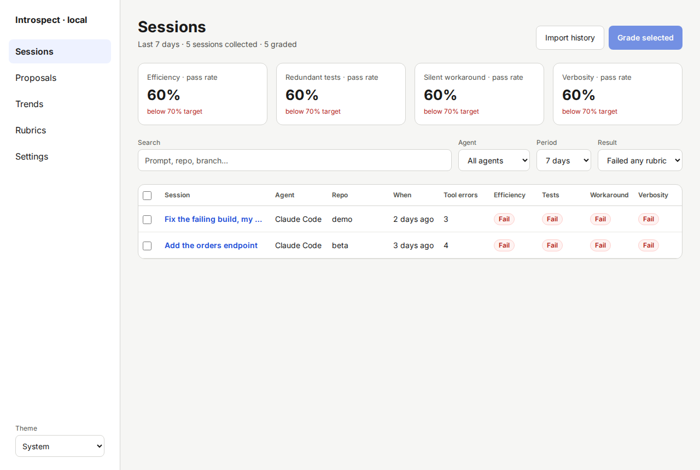
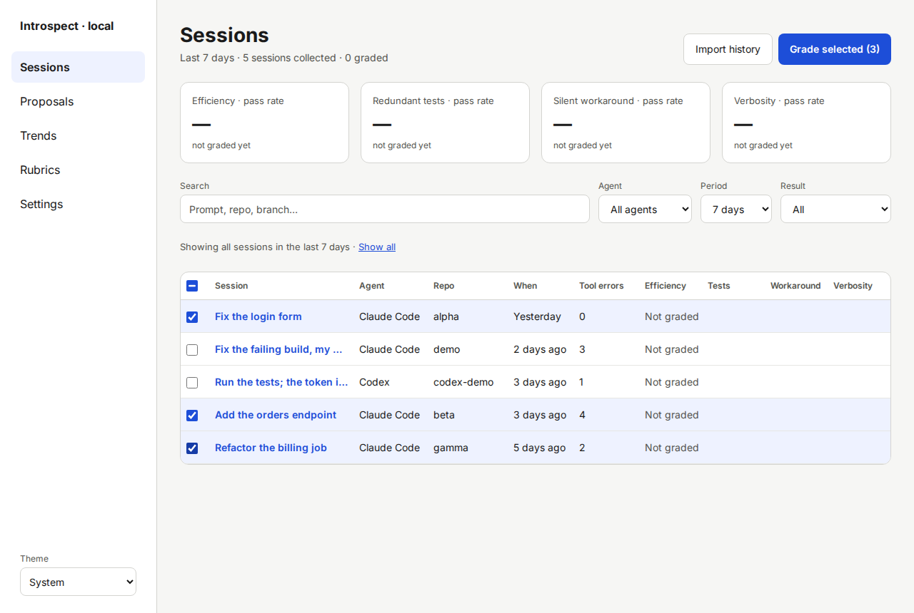
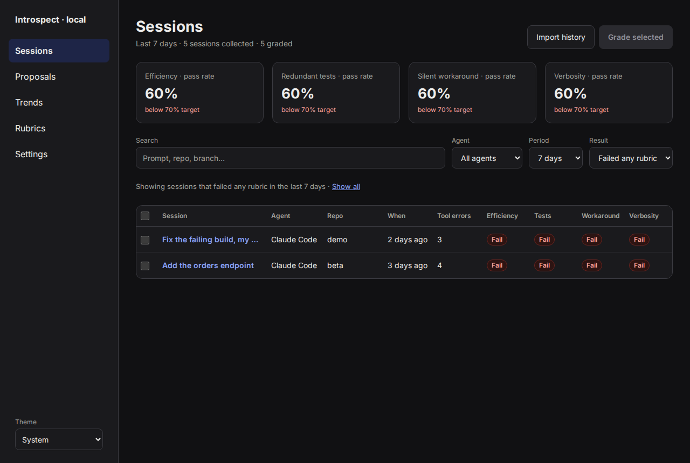

# Sessions

The Sessions screen is the home page.
It lists the sessions Introspect imported, shows the pass rate of each rubric, and starts grading.
Open it with **Sessions** in the left menu.

## What you see

**Header.**
The subtitle reads, for example, "Last 7 days · 5 sessions collected · 5 graded".
The first part follows the **Period** filter.

**Pass-rate cards.**
There is one card per rubric, for example "Efficiency · pass rate".
The card shows the share of graded sessions that passed.
A red line, for example "below 70% target", appears when the rate is under the target.
The default target is 70 %.
A rubric can set its own `target` (see [Writing and calibrating rubrics](12-writing-and-calibrating-rubrics.md)).
"Not graded yet" means no session in the period has a grade for this rubric.

**Filters.**

| Filter | Choices |
|---|---|
| **Search** | Text in the prompt, repo or branch |
| **Agent** | **All agents**, **Claude Code**, **Codex** |
| **Person** | **Everyone**, or one person. Shown only when sessions of more than one person exist. |
| **Period** | **7 days**, **30 days**, **All time** |
| **Result** | **Failed any rubric**, **All**, **Not graded** |

**Result** starts as **Failed any rubric** once something is graded.
Before anything is graded it starts as **All**, because the other choice would show an empty list.

**Table.**
Each row is one session.

| Column | Meaning |
|---|---|
| Checkbox | Selects the session for grading |
| **Session** | The first prompt. Click it to open [Session detail](07-screen-session-detail.md). |
| **Agent** | Claude Code or Codex |
| **Person** | Who pushed the session. Shown only when sessions of more than one person exist. See [Sharing sessions](20-sharing-sessions.md). |
| **Repo** | The repo folder name the session ran in |
| **When** | When the session started |
| **Tool errors** | Number of failed tool calls. Five or more appear in red. |
| One column per rubric | **Pass** or **Fail**. Hold the pointer over a column name to see the full rubric name. |

A row without grades shows **Not graded**.
Hold the pointer over it to see the reason, for example that redaction was off.

## Grade sessions by hand

Introspect grades sessions by itself after they end.
It grades sessions that signals flagged (for example many failed tool calls) and a 20 % random sample.
Use the following procedure to grade other sessions now.

> **NOTICE: Grading sends the redacted session to Anthropic and uses your budget.**
> Every selected session is graded with every rubric, so "Select all" on a long list can use the whole daily budget.
> When the budget is used up, a banner shows on this screen and on Proposals.
> The improver then waits too, until the budget resets or you raise it in **Settings › Judge and budget**.

1. Tick the checkbox of each session to grade.

   The row turns blue.
   The button shows the count, for example **Grade selected (3)**.

   To select every loaded row, tick the box in the table header.

2. Click **Grade selected (3)**.

   If the selection would use more than the tokens left today, Introspect asks first.
   The message reads, for example, "Grading 50 sessions × 4 rubrics uses about 12M tokens; 3M left today. About 12 sessions fit."
   The estimate is rough: it assumes about 60k tokens for each session and rubric.
   Choose **Grade 12 that fit** to grade only that many, **Grade all anyway (rest waits for tomorrow)** to queue everything, or **Cancel**.

   The note "Grading…" with a counter appears next to the buttons.

3. Wait for the note "Graded."

   The cards and the table show the new grades.
   Set **Result** to **All** to see passing sessions too.

If grading does not start or stops, see [Troubleshooting](16-troubleshooting.md).

## Import sessions

**Import history** reads all source folders again.
Introspect also watches the folders and the import is safe to repeat: it never creates duplicates.
Use it after you add a source folder, or if a new session does not show up.
The note next to the button shows "Importing… 12 / 36" and then "Import finished."

## Empty states

- **No sessions collected yet**: no source has sessions.
  Click **Check source folders** to open [Settings](11-screen-settings.md).
- **No sessions match these filters**: click **Clear filters**, or widen the period.
- **Load more** at the end of the table loads the next page.

## Dark theme

The **Theme** menu at the bottom of the left menu offers **System**, **Light** and **Dark**.
The default, **System**, follows your operating system.

