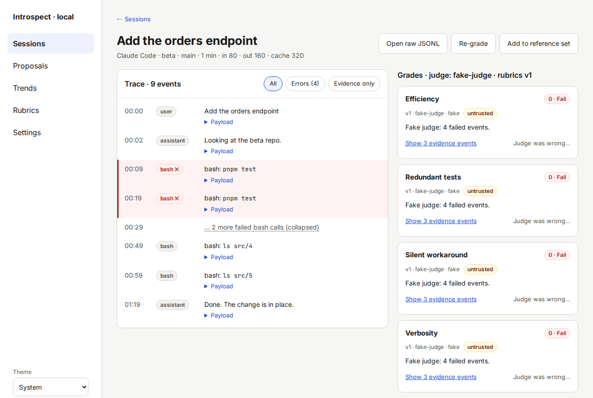
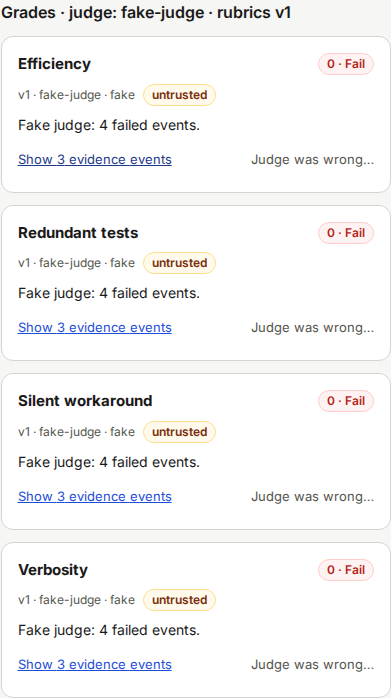
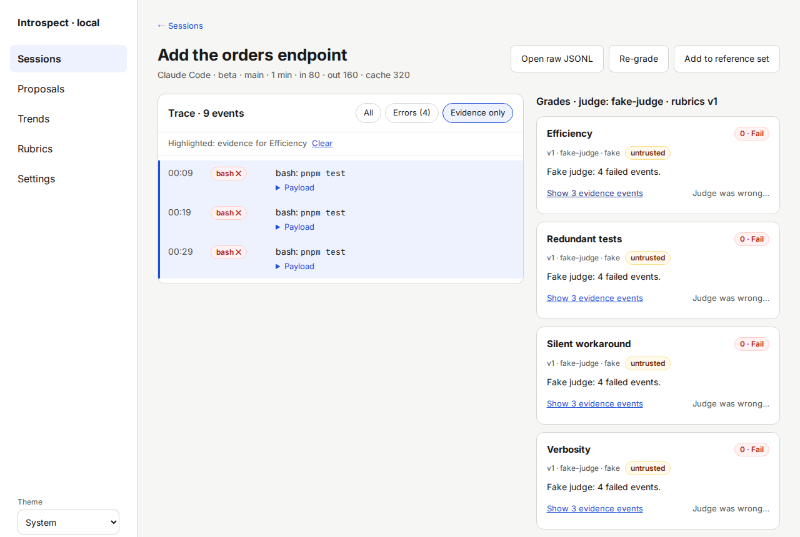
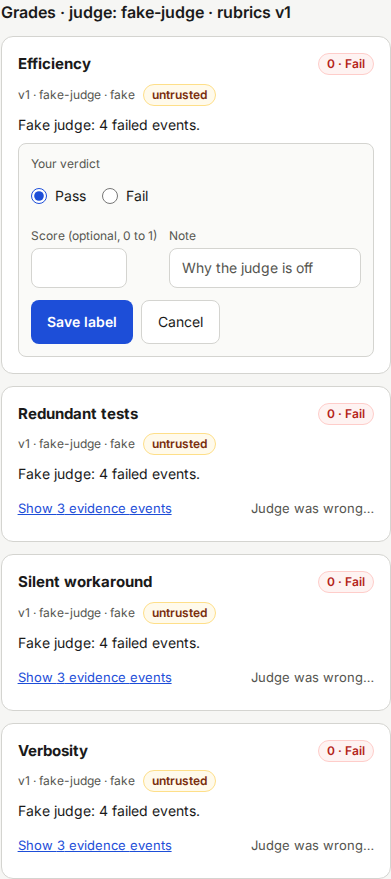

# Session detail

The Session detail screen shows what the agent did in one session, and how each rubric graded it.
Open it by clicking a session title on the [Sessions](06-screen-sessions.md) screen.
**← Sessions** returns to the list.

## Header

The heading is the first prompt of the session.
Under it you see the agent, repo, branch, duration and token counts.
If the session ended with a pull request, a link to it appears here.

Buttons:

| Button | What it does |
|---|---|
| **Open raw JSONL** | Opens the original log file in a new tab. This shows the file as the agent wrote it. |
| **Re-grade** | Grades this session again with the current rubrics. |
| **Add to reference set** / **Remove from reference set** | Pins the session. See [Reading trends](14-reading-trends.md). |

## Trace

The **Trace** lists the events in order, with a time offset from the start.
Each row has a label (for example `user`, `assistant`, `bash`) and a short text.
A failed tool call is red and shows a cross.
Click **Payload** under a row to see its input and output.
Secrets in payloads show as `[REDACTED:…]`.
A payload longer than 64 KiB is cut.
After the retention period, **Payload removed by the retention purge.** appears instead.

Long runs of the same failed call fold into one line, for example "… 2 more failed bash calls (collapsed)".
Click the line to unfold it.

Filter buttons above the trace:

- **All**
- **Errors (4)**: only failed calls.
- **Evidence only**: only the events a judge cited.
  It is disabled until the session is graded.

## Grades

The **Grades** panel has one card per rubric.
Its heading names the judge model and the rubric version, for example "Grades · judge: fake-judge · rubrics v1".

Each card shows:

- the rubric name and a verdict chip, for example **0 · Fail**.
  The number is the score on the rubric scale.
  A score at or above the pass threshold passes.
- the rubric version, the judge model and how it ran (**API** or **claude CLI**).
- the chip **untrusted** if the rubric has not passed the calibration gate yet.
  Such a rubric still grades, but the improver ignores it.
  See [Writing and calibrating rubrics](12-writing-and-calibrating-rubrics.md).
- the judge's reason in one paragraph.
- **Show 3 evidence events**: opens the events the judge cited.
- **Judge was wrong…**: lets you record your own verdict.

Other chips:

- **stale — re-grading**: a newer rubric version is being graded, and this verdict comes from the old one.
- **judge refused** and **invalid verdict**: the judge returned no usable answer.
  Click **Re-grade** to try again.

### Check the evidence

1. Click **Show 3 evidence events** on a card.

   The trace switches to **Evidence only**.
   A line "Highlighted: evidence for Efficiency" appears, and the cited events have a blue bar.

   

2. Click **Clear** in that line, or **All**, to return to the full trace.

   The full trace shows again.

### Tell Introspect the judge was wrong

Your labels are what makes a rubric trusted.
Add a label when you disagree with a grade, and also when you agree and want to record it (use **Add label…** on the [Rubrics](08-screen-rubrics.md) screen for that).

1. Click **Judge was wrong…** on the card.

   A form opens with **Your verdict** preset to the opposite of the judge's verdict.

2. Check **Pass** or **Fail**.

   Your choice is selected.

3. Optional: enter a **Score (optional, 0 to 1)** and a **Note**, for example why the judge is off.

   The fields keep your input.

4. Click **Save label**.

   The card shows the note "Label saved. It counts toward the calibration of Efficiency."
   The link opens the Rubrics screen.

Click **Cancel** to close the form without saving.

A session with a label is pinned: the retention purge never removes its payloads.

## Not graded yet

A session without grades shows **Not graded yet** in the panel.
Click **Re-grade** to grade it now.
