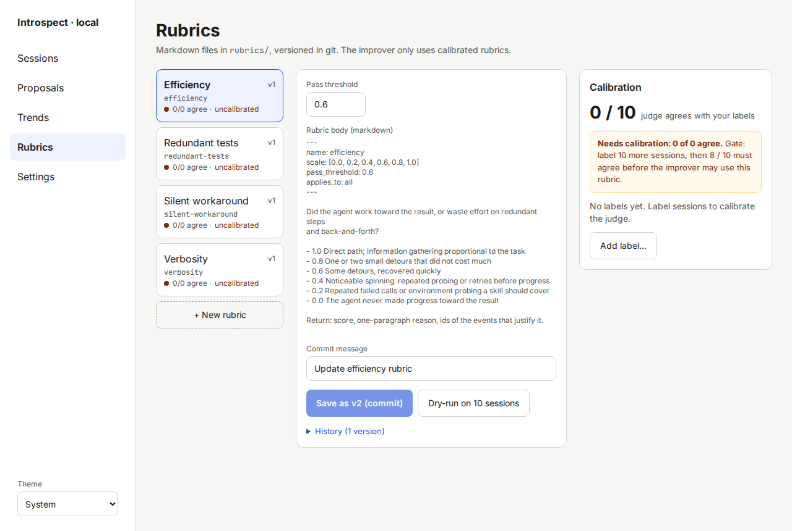
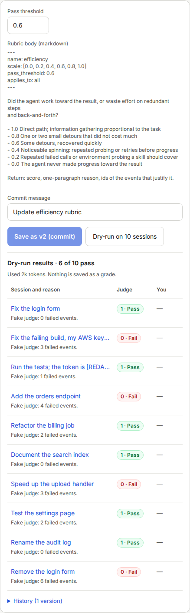
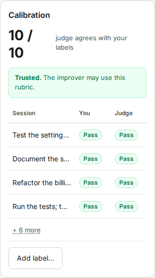

# Rubrics

The Rubrics screen shows the rubric files in the `rubrics/` folder of your skills repo.
You read, edit, test and calibrate rubrics here.
Open it with **Rubrics** in the left menu.

The task pages explain how to write a rubric and how to calibrate it: [Writing and calibrating rubrics](12-writing-and-calibrating-rubrics.md).
This page describes the screen.

## Rubric list

The list on the left has one entry per rubric.
Each entry shows the rubric name, its version (`v1`), the file name, and the agreement with your labels, for example "10/10 agree · trusted" or "0/0 agree · uncalibrated".
Click an entry to open it.
**+ New rubric** opens a small form.
Type a name in **Rubric name** (lowercase letters, digits and dashes) and click **Create**.
Introspect creates `rubrics/<name>.md` from a template and commits it.

## Editor

The **Editor** panel edits the whole rubric file.

| Element | Meaning |
|---|---|
| **Pass threshold** | The lowest score that counts as a pass. It must be one of the scale values. Changing it updates the file header as well. |
| **Rubric body (markdown)** | The file, including the header between the `---` lines. |
| **Commit message** | The git commit message for the save. It starts as "Update <name> rubric". |
| **Save as v2 (commit)** | Saves a new version and commits it to the skills repo. The button is disabled until you change something. |
| **Dry-run on 10 sessions** | Grades sessions with your unsaved draft. Nothing is saved as a grade. |
| **Sessions** | Appears once you have labels. Choose **Calibration sessions** or **Most recent sessions** for the dry-run. |
| **History (2 versions)** | Lists the saved versions with their git commit. |

After you save, the page shows "Saved as v2 and committed to your skills repo."
A new version makes the older grades **stale**, and Introspect grades the affected sessions again.
It also adds a baseline reset on the [Trends](10-screen-trends.md) screen.

### Dry-run results

The heading shows how many sessions passed, for example "Dry-run results · 6 of 10 pass".
A line under it shows the tokens used.
The table has one row per session: the title and reason, the **Judge** verdict, and **You**, your own label if you made one.
A row where your label and the judge disagree is highlighted.
A dry-run uses tokens and counts toward your budget.

## Calibration panel

The **Calibration** panel on the right shows how well the judge agrees with you.

- The big number, for example "10 / 10", is the count of agreeing labels over the number of labels (at least 10).
- A coloured box says **Trusted.** or **Needs calibration: 0 of 0 agree.**
  It also states the gate: you need 10 labels, and 8 of them must agree.
- The table lists each labelled session with **You** and **Judge** verdicts.
  Disagreements are highlighted.
  "+ 6 more" shows the rest.
- **Add label…** records a label for a session you pick.
  See [Writing and calibrating rubrics](12-writing-and-calibrating-rubrics.md).

## Empty states

- **No skills repo set up yet**: click **Set up a skills repo in Settings**.
- **No rubrics in your skills repo yet**: click **Copy starter rubrics in Settings**.
