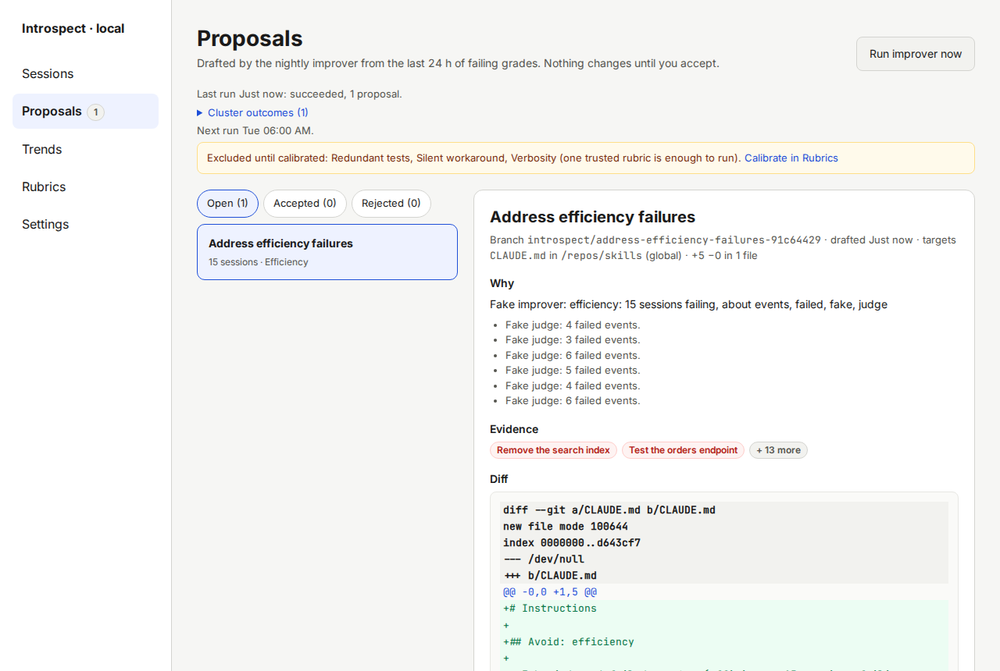
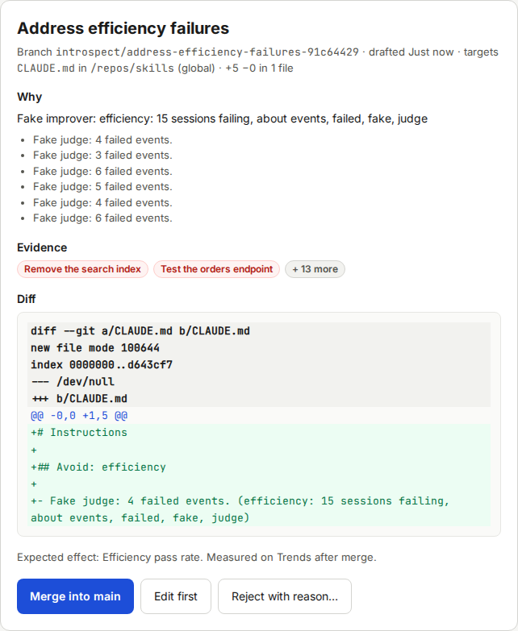
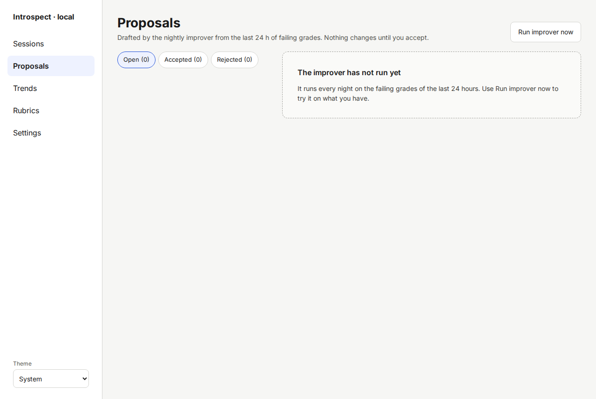

# Proposals

The Proposals screen is the inbox for changes the improver drafted.
Each proposal is a small change to your instruction files on its own git branch.
Nothing changes in your repos until you accept one.
Open the screen with **Proposals** in the left menu.
A number next to the menu entry counts the open proposals.

The task page [Reviewing and accepting proposals](13-reviewing-and-accepting-proposals.md) explains the decisions.
This page describes the screen.

## Header

- **Run improver now** starts the improver at once.
  It uses tokens and sends redacted content to Anthropic.
  Normally it runs every day at 06:00 (see [Settings](11-screen-settings.md)).
  The schedule follows the server time zone (`TZ` in `.env`, default UTC).
  The browser shows times in your local time, so "06:00" can appear at another hour.
- The line "Last run Just now: succeeded, 1 proposal." reports the last run.
  **Cluster outcomes (1)** lists what the improver did with each group of failures.
- The improver looks at grades made in the last 24 hours.
  The window applies to when a session was graded, not to when it happened.
  A session you graded today counts, even if it ran last week.
- When the daily token budget is used up, a banner says so and tells you when grading and the improver resume.
- "Next run Tue 06:00 AM." tells you when the next scheduled run starts.
- A line such as "Excluded until calibrated: Redundant tests, Silent workaround, Verbosity (one trusted rubric is enough to run)" names the rubrics the improver skipped because they are not trusted.
  One trusted rubric is enough for a run: the improver works on the trusted rubrics and lists the others here.
  **Calibrate in Rubrics** opens the Rubrics screen.

## Tabs

| Tab | Shows |
|---|---|
| **Open** | Proposals waiting for your decision |
| **Needs attention** | Proposals with a merge conflict or a diff that failed the safety checks. The tab appears only when there are any. |
| **Accepted** | Merged proposals, with their merge commit, or with a link to the pull request |
| **Rejected** | Rejected proposals and proposals that a newer proposal replaced |

The number in brackets counts the proposals in the tab.

## Proposal detail

Click a proposal in the list to open it on the right.

- **Title** and a line with the git branch, the time it was drafted, the files it changes, the repo and the size of the change, for example "+5 −0 in 1 file".
- **Why**: the improver's rationale, and the judge reasons of the failing sessions.
- **Evidence**: the failing sessions behind the proposal, as links. "+ 13 more" shows the rest.
- **Diff**: the change in unified diff format.
  Green lines are added, red lines are removed.
- A warning box "Executable change" appears if the diff touches files that Claude Code executes.
  See [Safety and privacy notes](02-safety-and-privacy.md).
- A red box "This diff does not validate." lists why Introspect cannot accept the diff.
- **Expected effect**: the rubrics whose pass rate the change should raise.

The buttons below depend on the status.

| Button | When | What it does |
|---|---|---|
| **Merge into main** | Accept mode "Merging locally" | Merges the branch into the default branch of the repo |
| **Open pull request** | Accept mode "Opening a pull request" | Pushes the branch and opens a pull request with `gh` |
| **Edit first** | Always while open | Lets you change the diff before you accept |
| **Reject with reason…** | Always while open | Rejects the proposal with a note |

## Empty states

- **No rubric is trusted yet**: label sessions until one rubric passes the calibration gate.
  Click **Calibrate a rubric**.
- **The improver has not run yet**: click **Run improver now**.

  

- **No open proposals**: the last run found nothing worth fixing.
