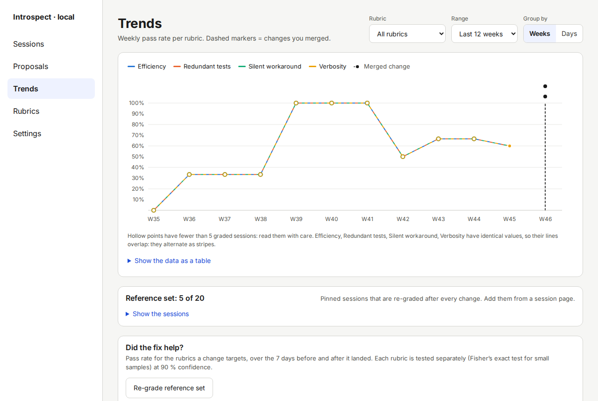
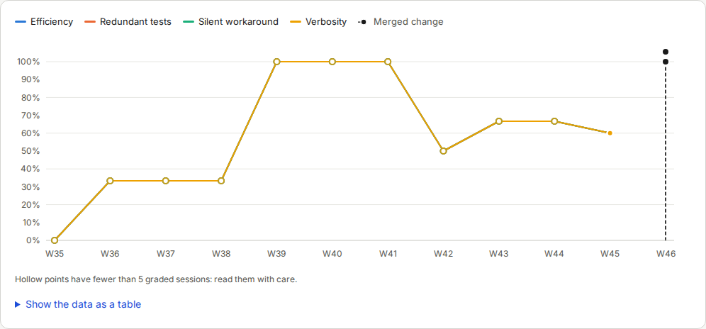
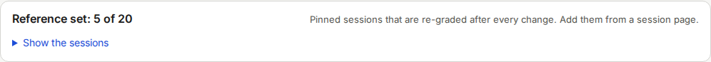
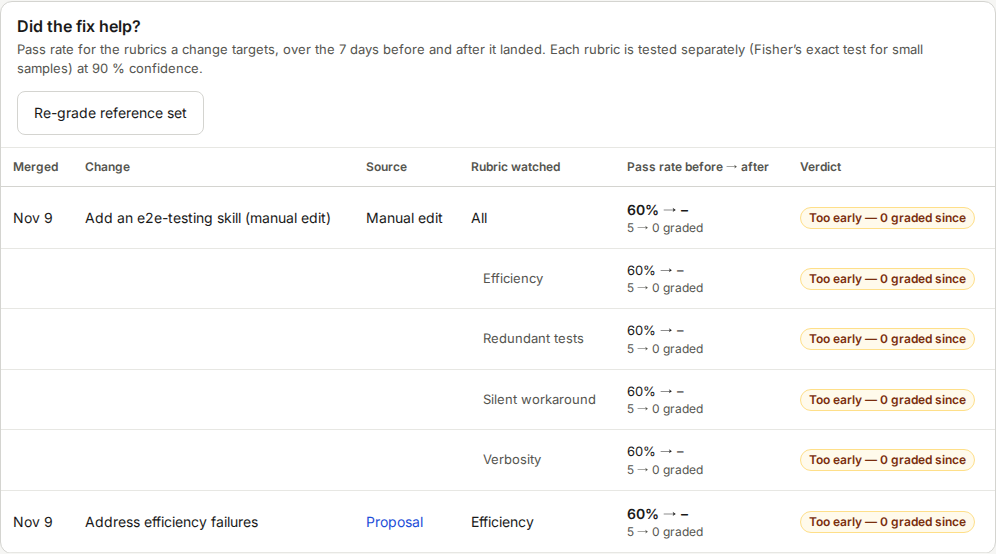

# Trends

The Trends screen shows whether your pass rates change over time, and whether a change you made helped.
Open it with **Trends** in the left menu.

[Reading trends](14-reading-trends.md) explains how to interpret what you see.
This page describes the screen.

## Controls

| Control | Choices |
|---|---|
| **Rubric** | **All rubrics**, or one rubric |
| **Range** | **Last 4 weeks**, **Last 12 weeks**, **Last 26 weeks** |
| **Group by** | **Weeks** or **Days** |

Without graded sessions the screen shows **Not enough graded sessions yet**.
Click **Back to Sessions** and grade a few sessions first.

## Pass rate chart

The chart draws one line per rubric.
Each point is the share of graded sessions in that week or day that passed.
The legend above the chart names the lines and the markers:

| Legend entry | Marker |
|---|---|
| **Target** | A dashed horizontal line at the target pass rate of a rubric |
| **Merged change** | A dashed vertical line with a dot. It marks an accepted proposal or a manual edit of a skill or instruction file. |
| **Baseline reset** | A hollow diamond. It marks a change of a rubric or of the judge model. |

A **hollow point** has fewer than 5 graded sessions.
Read it with care: one session moves it a lot.
Hover over a point or a marker to see the details.
Click a marker to see what changed.

Under the chart, **Show the data as a table** opens the same numbers as a table, for keyboard and screen reader use.

## Reference set

The card **Reference set: 5 of 20** shows the pinned sessions.
Introspect grades these sessions again after every rubric or judge change, so that before and after are comparable.
Click **Show the sessions** to see them.

You add a session on its [Session detail](07-screen-session-detail.md) screen with **Add to reference set**.
The set holds up to 20 sessions.

## Change log: Did the fix help?

The change log is a table with one row per change.

| Column | Meaning |
|---|---|
| **Merged** | The date of the change |
| **Change** | The title of the proposal, or the commit message of a manual edit |
| **Source** | **Proposal** (a link to it), **Manual edit**, or **Rubric change** |
| **Rubric watched** | The rubrics the change targets, or **All** |
| **Pass rate before → after** | The pass rate in the 7 days before and after the change, and the number of graded sessions on each side |
| **Verdict** | **Improved**, **Worse**, **No change**, or **Too early — N graded since** |

A baseline reset row shows "baseline reset" instead of numbers.
A change that targets several rubrics has one extra row per rubric.

**Re-grade reference set** grades the pinned sessions again now.
If the set is empty, the screen says: The reference set is empty, and asks you to open a session and choose “Add to reference set” first.

To get an after-change verdict, grade more sessions after the change and wait until the compare window has passed.
The default window is 7 days (see [Settings](11-screen-settings.md)).
Until enough sessions are graded after the change, the verdict stays **Too early — N graded since**.
Sessions that ran after the change are graded by themselves, or you can select them on the [Sessions](06-screen-sessions.md) screen.

If the log is empty, it shows **No changes merged yet**.
Accept a proposal, or edit a skill in your skills repo, and the change appears.
Introspect finds manual edits by scanning the repos every 15 minutes.
`introspect scan` runs the scan at once (see [Command reference](18-command-reference.md)).
