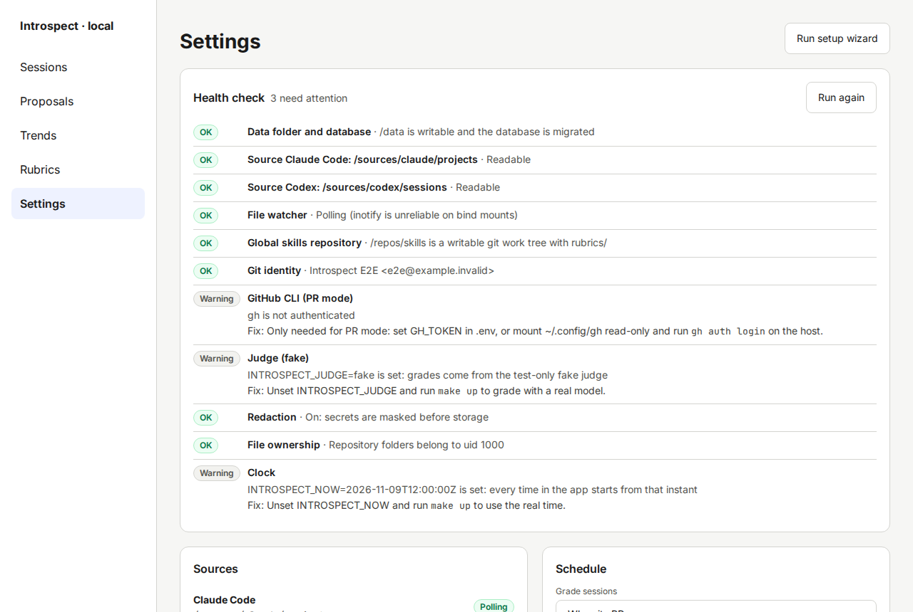
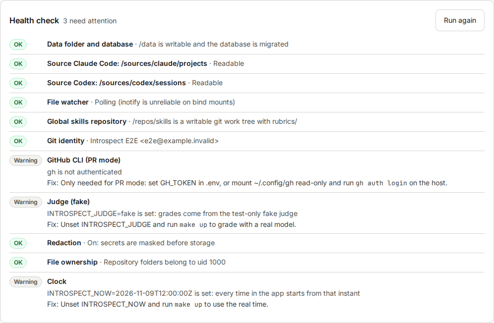
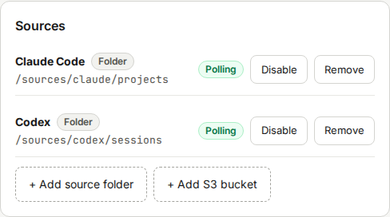
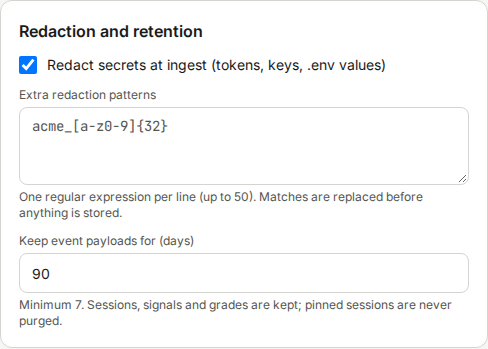
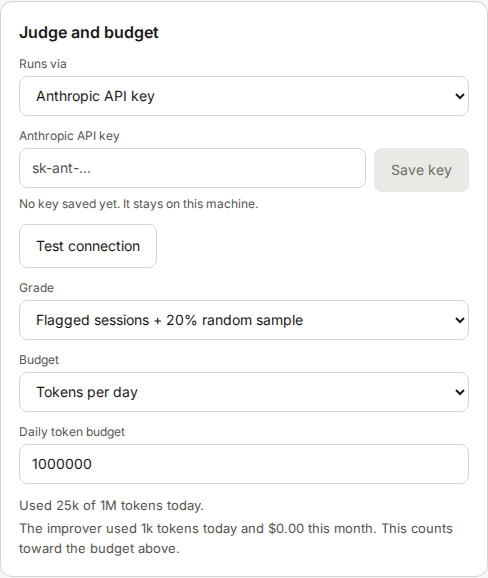
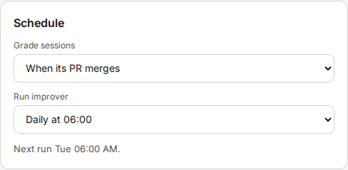
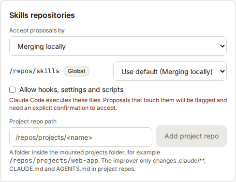
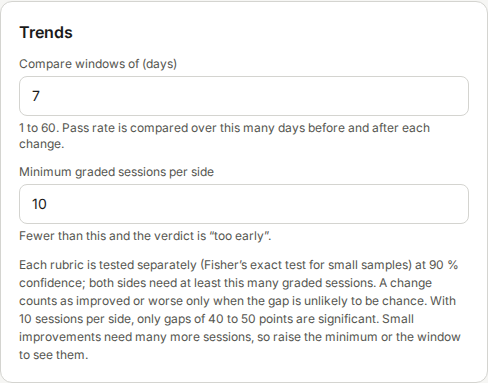

# Settings and Health check

The Settings screen holds every option, and the **Health check**.
Below the Health check are seven cards: **Sources**, **Redaction and retention**, **Judge and budget**, **Schedule**, **Skills repositories**, **Trends** and **Team mode**.
Open it with **Settings** in the left menu.

Most settings save by themselves.
A checkbox or a list saves when you change it.
A number saves when you leave the field.
The line "All changes saved." confirms it.
If a value is not valid, the field shows a hint in red and nothing is saved.

**Run setup wizard** at the top opens the [setup wizard](05-setup-wizard.md) again.

The full list of settings with their defaults is in the [configuration reference](15-configuration-reference.md).

## Health check

The Health check runs the same checks as `introspect doctor` (see [Troubleshooting](16-troubleshooting.md)).
The heading shows "Everything works." or, for example, "3 need attention".

Each line has a status chip:

| Chip | Meaning |
|---|---|
| **OK** | The check passed. |
| **Warning** | Something is missing, but Introspect still works. Often the item is optional. |
| **Failing** | Something is broken and a function does not work. |

Lines that need attention show the detail and a line "Fix: …" with the command to run.
Click **Run again** after you fix something.

> **NOTICE: This screenshot comes from a demo setup.**
> It shows warnings for "Judge (fake)" and "Clock" because the demo runs a test judge and a fixed date.
> A normal setup does not show these two.

## Sources

The **Sources** card lists the session log folders with a status chip: **Watching**, **Polling**, **Disabled** or **Not found**.
In Docker the chip is **Polling**, because Introspect checks the folders at intervals instead of waiting for file events.
**+ Add source folder** adds a folder: choose the agent, enter the **Folder path** and click **Add folder**.
Folders must be readable inside the container, so a new folder also needs a mount.

## Redaction and retention

- **Redact secrets at ingest (tokens, keys, .env values)**: on by default.
  Turn it off only for tests.
  Sessions stored while it is off are never sent to a judge.
- **Extra redaction patterns**: one regular expression per line, up to 50.
  A pattern that is not valid shows a hint, and nothing is saved.
- **Keep event payloads for (days)**: default 90, minimum 7.

## Judge and budget

| Field | Meaning |
|---|---|
| **Runs via** | **Anthropic API key** or **Local claude CLI (headless)** |
| **Anthropic API key** | Paste a key and click **Save key**. The hint says whether a key is already saved. |
| **Claude login in the container** | Shown for the CLI. The chip says **Logged in** or **Not logged in**. If it says **Not logged in**, run `make claude-login`, then click **Check again**. |
| **Test connection** | Checks that the judge works |
| **Grade** | **Flagged sessions + 20% random sample**, or **Every session** |
| **Budget** | **Tokens per day**, **Tokens per day + monthly dollar ceiling**, or **Monthly dollar ceiling only** |
| **Daily token budget** | Default 1000000 |
| **Monthly ceiling (USD)** | Only for the dollar modes |

Below the budget, a line shows the use so far, for example "Used 25k of 1M tokens today."
If the limit is reached, it also says that grading waits until midnight, or until next month.
The time zone for these windows comes from `TZ` in `.env`.
Schedules (grading and the improver) follow the same server time zone, default UTC.
The browser shows times in your local time.

## Schedule

| Field | Meaning |
|---|---|
| **Grade sessions** | **When a session ends**, or **When its PR merges** |
| **Run improver** | **Daily at 06:00**, **Weekly, Monday 06:00**, or **Manually**. A run missed while the computer was off runs once at the next start. |

A line below the fields shows when the next run starts.

## Skills repositories

The card starts with one global default:

- **Accept proposals by**: **Merging locally** or **Opening a pull request**.

Below it, a list shows each repo once, the global skills repo first, then the project repos.
Each row has:

- The path, and a chip: **Global**, **Project** or **Disabled**.
- A list that overrides the default for this repo: **Use default (Merging locally)**, **Merging locally** or **Opening a pull request**.
  The first entry names the current default.
- **Allow hooks, settings and scripts**: off by default.
  Read the [safety notes](02-safety-and-privacy.md) before you turn it on.
  A confirmation box asks you to click **Allow**.
  **Cancel** leaves the option off.

If the global repo has no `rubrics/` folder, its row says so.
Run the [setup wizard](05-setup-wizard.md) to copy the starter rubrics.
If no global repo is set, the card tells you to use the Health check or the wizard.

**Project repo path** with **Add project repo** registers a project repo.
The path must be inside the mounted projects folder, for example `/repos/projects/web-app`, and the folder name must match the repo's folder name.
The improver changes only `.claude/**`, `CLAUDE.md` and `AGENTS.md` in project repos.

## Trends

- **Compare windows of (days)**: 1 to 60, default 7.
- **Minimum graded sessions per side**: default 10.
  With fewer sessions the verdict is "too early".

See [Reading trends](14-reading-trends.md).

## Team mode

The **Team mode** card is a placeholder for a later phase.
Its fields are disabled.
