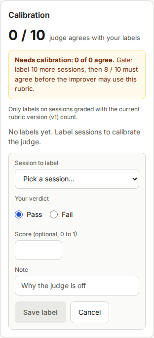
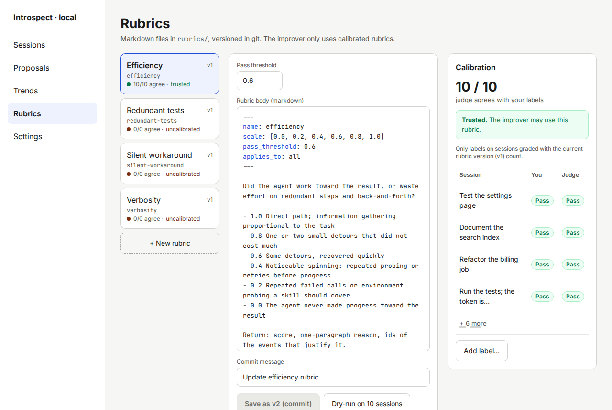

# Writing and calibrating rubrics

A rubric tells the judge what a good session looks like.
This page shows how to write one and how to prove that the judge understands it.

## The rubric file

A rubric is a Markdown file in the `rubrics/` folder of your skills repo.
The file name is the rubric name, plus `.md`.
Introspect ships four starter rubrics: `efficiency`, `redundant-tests`, `verbosity` and `silent-workaround`.

This is the `efficiency` starter rubric:

```markdown
---
name: efficiency
scale: [0.0, 0.2, 0.4, 0.6, 0.8, 1.0]
pass_threshold: 0.6
applies_to: all
---

Did the agent work toward the result, or waste effort on redundant steps and back-and-forth?

- 1.0 Direct path; information gathering proportional to the task
- 0.8 One or two small detours that did not cost much
- 0.6 Some detours, recovered quickly
- 0.4 Noticeable spinning: repeated probing or retries before progress
- 0.2 Repeated failed calls or environment probing a skill should cover
- 0.0 The agent never made progress toward the result

Return: score, one-paragraph reason, ids of the events that justify it.
```

### Header fields

The header sits between the two `---` lines.
Each field is one line in the form `key: value`.

| Field | Required | Rule |
|---|---|---|
| `name` | Yes | Lowercase letters, digits and dashes, up to 64 characters. It must equal the file name without `.md`. |
| `scale` | Yes | A list of at least two numbers, for example `[0.0, 0.5, 1.0]`. No repeats. |
| `pass_threshold` | Yes | One of the numbers in `scale`. A score at or above it is a pass. |
| `applies_to` | No | Free text. The default is `all`. |
| `target` | No | The pass rate you aim for, from 0 to 1. The Trends chart and the pass-rate cards use it. The default is 0.7. |

The body must not be empty.

### Body

Write for the judge, in plain language.

- Ask one question.
  A rubric that measures two things gives scores you cannot interpret.
- Describe each score level in behaviour the judge can see in a trace: failed calls, repeated commands, long replies.
- End with the line "Return: score, one-paragraph reason, ids of the events that justify it."
  The judge's evidence links on the [Session detail](07-screen-session-detail.md) screen depend on it.

If the file is invalid, the Health check shows a "Rubric files" warning with the reason.
See [Troubleshooting](16-troubleshooting.md).

## Add a rubric

1. Open the [Rubrics](08-screen-rubrics.md) screen and click **+ New rubric**.

   A form with the field **Rubric name** appears.

2. Enter a name such as `commit-size` and click **Create**.

   The new rubric opens with a template body and a commit in your skills repo.

3. Replace the template text in **Rubric body (markdown)** with your own text.

   The button **Save as v2 (commit)** becomes active.

4. Click **Dry-run on 10 sessions**.

   After a moment, a table shows how the judge would grade ten sessions.
   Nothing is saved as a grade.

5. Read the reasons.
   Change the body until the verdicts match what you expect.

   Each dry-run replaces the last table.

6. Edit **Commit message**, then click **Save as v2 (commit)**.

   The page shows "Saved as v2 and committed to your skills repo."
   Introspect grades the affected sessions again.

You can also create or edit the file in your editor.
Introspect reads the `rubrics/` folder each time, so the change shows up on the Rubrics screen.
Commit it, so that git tracks the change.

## The calibration gate

A judge can misread a rubric.
Introspect therefore does not let the improver learn from a rubric until you have shown that the judge agrees with you.

- You label sessions yourself: **Pass** or **Fail**.
- The judge's verdict on the same sessions is compared with your labels.
- **The gate is 8 of 10.** The rubric is **trusted** when the judge has graded at least 10 of your labelled sessions with the current rubric version, and agrees with at least 80 % of them (8 of 10).
  Until then the rubric is **uncalibrated**.

An uncalibrated rubric still grades and still counts on the Sessions screen.
The improver leaves it out and says so on the [Proposals](09-screen-proposals.md) screen.

A new rubric version needs new judge grades.
Your labels stay.
The comparison counts a label only when the judge has graded that session with the current version, so the agreement count rises again as the sessions are graded with the new text.

## Calibrate a rubric

You need at least ten graded sessions, with a mix of passes and fails.
Choose sessions where you are sure of the answer.

1. Open the rubric on the Rubrics screen.

   The **Calibration** panel shows "0 / 10" and **Needs calibration**.

2. Click **Add label…**.

   A form opens with the field **Session to label**.

   

3. Choose a session in **Session to label**.

   Open the session in another tab to read the trace if you are unsure.

4. Select your verdict under **Your verdict**: **Pass** or **Fail**.

   Your choice is selected.

5. Optional: add a **Note**.

   A note helps you remember why you disagreed with the judge.

6. Click **Save label**.

   The label appears in the table of the Calibration panel, next to the judge's verdict.
   Agreement shows in the list on the left, for example "1/1 agree".

7. Repeat steps 2 to 6 until you have ten labels.

   The panel shows "10 / 10" when all ten agree.

8. Check the result.

   If at least eight labels agree, the box turns green and says **Trusted.
   The improver may use this rubric.**
   If fewer agree, read the disagreements, which are highlighted, and improve the rubric text (see below).



You can also label from a session: use **Judge was wrong…** on the [Session detail](07-screen-session-detail.md) screen.
That form is preset to the opposite of the judge's verdict.
Use **Add label…** when you agree with the judge and want to record it.

Aim for a balanced set: about five passes and five fails.
Ten labels that all say "pass" would make an uninformative gate.

## If the judge disagrees too often

1. Open the disagreeing sessions from the table in the Calibration panel.

   Read the judge's reason on each session.

2. Find what the judge misread, and make the rubric text more precise.

   Edit the body in the Editor.

3. Click **Dry-run on 10 sessions**, and choose **Calibration sessions** in **Sessions**.

   The table shows the judge's new verdict beside your label for each session.

4. When the verdicts match your labels, click **Save as v2 (commit)**.

   Introspect grades the affected sessions again, and the agreement count updates when the new grades arrive.

## Reference set

The reference set is a fixed group of up to 20 sessions that Introspect grades again after every rubric or judge change.
It makes the pass rates before and after a change comparable.
Add typical sessions with **Add to reference set** on the Session detail screen.
See [Reading trends](14-reading-trends.md).
