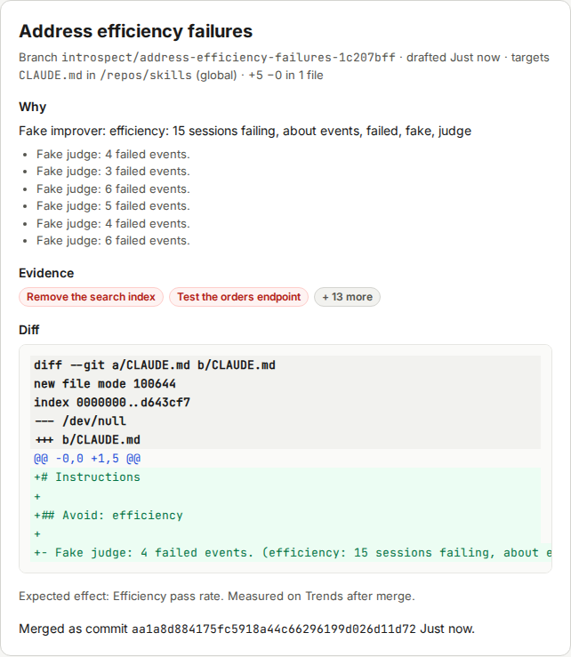
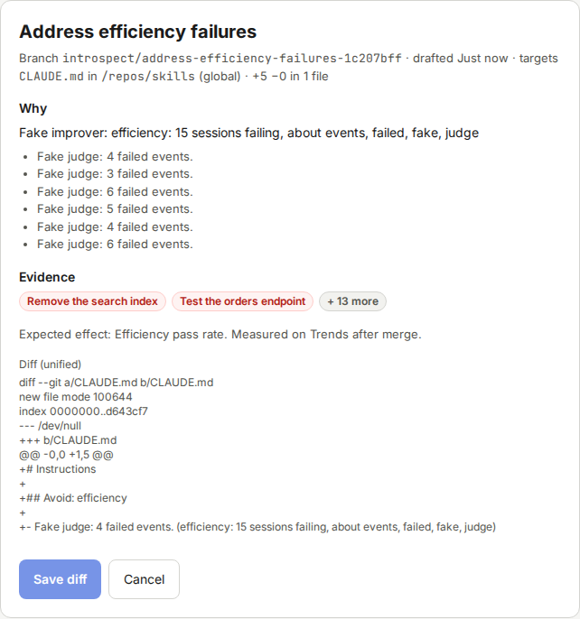
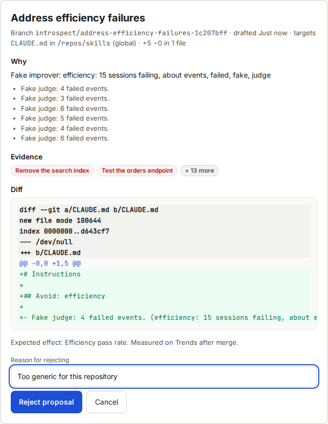

# Reviewing and accepting proposals

This page shows how to decide on a proposal.
You need at least one open proposal.
To create one, you need a trusted rubric (see [Writing and calibrating rubrics](12-writing-and-calibrating-rubrics.md)) and graded sessions that failed it.

## How proposals come to be

The improver runs every day at 06:00, or when you click **Run improver now**.
It follows these rules:

- It looks only at failing grades of trusted rubrics.
  Failures of untrusted rubrics are listed in the run summary and left out.
- It groups failures by repo and rubric, then by the words in the judge's reasons.
  The grouping is simple: a cause that the judge describes in different words can end up in separate groups.
- Each of the three largest groups gets one proposal.
- A group that the improver declined, or that failed, is not billed again for 7 days, unless new failing sessions join it.

Each proposal targets one repo.

- A **project repo** you registered, if the sessions ran in it.
  Only `.claude/skills/**`, `.claude/commands/**`, `.claude/agents/**`, `CLAUDE.md` and `AGENTS.md` can change.
- Otherwise your **global skills repo**.
  Only `skills/**`, `commands/**`, `agents/**`, `CLAUDE.md` and `AGENTS.md` can change.

The improver never changes `rubrics/`.
It works on a separate branch named `introspect/<slug>` in a git worktree, so your working copy stays untouched until you accept.

Introspect refuses a diff that leaves the allowed paths, changes more than 5 files or 300 lines, contains a binary, hides invisible characters, or adds text that the redaction rules would mask.
It also refuses hooks, `settings*.json`, scripts and symlinks, unless you opted in for that repo.

## Review a proposal

1. Open the [Proposals](09-screen-proposals.md) screen and select a proposal in the **Open** tab.

   The right side shows the title, the branch and the target files.

2. Read **Why**.

   You see the improver's rationale and the judge reasons from the failing sessions.

3. Check **Evidence**.

   Click one or two sessions to confirm that the failure is real and that the cause matches the rationale.
   Evidence chips are links to [Session detail](07-screen-session-detail.md).

4. Read **Diff**.

   Check that the new text is short, specific and says what you want.
   Check that it does not repeat or contradict an existing instruction.

5. Check for warnings.

   A box "Executable change" means the diff touches a file that Claude Code executes.
   Read it line by line.
   A red box "This diff does not validate." means you cannot accept the diff as it is.
   Use **Edit first** to fix it, or reject it.

6. Decide: accept, edit first, or reject.

## Accept

How the button reads depends on the accept mode.
You set the mode in Settings (**Accept a proposal by**), and you can override it for each repo.

### Merge locally

The button reads **Merge into main**.
Use it when you work alone, or when the skills repo has no remote.

> **NOTICE: Merging changes your repo.**
> Introspect merges the branch with `git merge --no-ff` into the default branch.
> The default branch must be checked out in that repo, and its working tree must be clean.
> Otherwise Introspect refuses and explains why, and the proposal stays open.
> To undo a merge, use `git revert -m 1 <merge commit>` in the repo.

1. Make sure the repo has no uncommitted changes, and that its default branch is checked out.

   `git status` in the repo shows a clean tree.

2. Click **Merge into main**.

   The button reads "Working…" for a moment.
   Then the proposal shows "Merged as commit <id>", with the time.

   

3. Look at the repo.

   The default branch has a new merge commit, and your skills or instruction file contains the new text.

The proposal moves to the **Accepted** tab, and the change appears on the [Trends](10-screen-trends.md) chart as a **Merged change**.

### Open a pull request

The button reads **Open pull request**.
Use it when your skills repo lives on GitHub and others review it.
You need `GH_TOKEN` in `.env` (see the [configuration reference](15-configuration-reference.md)) and the `gh` check in the Health check must be green.

1. Click **Open pull request**.

   Introspect pushes the branch and runs `gh pr create`.
   The proposal shows "PR opened — waiting for merge", with the link.

2. Review and merge the pull request on GitHub.

   The change reaches the Trends chart after the merge.

The proposal stays in the **Open** tab, with "PR open" in the list, until the pull request merges.

## Edit first

Use this when the idea is right but the wording is not.

1. Click **Edit first**.

   The diff becomes an editable text field, **Diff (unified)**.

2. Change the lines you want to change.

   Keep the unified diff format.
   Edit only the lines after `+` and `-`.

3. Click **Save diff**.

   Introspect checks the diff again against all safety rules.
   If it is valid, the proposal shows your version.
   If not, a red box "Diff refused" lists the reasons.
   Fix them, or click **Cancel**.

   

4. Click **Merge into main** or **Open pull request**.

   The proposal is accepted with your edited diff.

## Reject

1. Click **Reject with reason…**.

   A field **Reason for rejecting** appears.

2. Enter a short reason, for example "Too generic for this repository".

   The button **Reject proposal** becomes active.

3. Click **Reject proposal**.

   The proposal shows "Rejected: <reason>" and moves to the **Rejected** tab.

   

If the proposal had an open pull request, Introspect closes it and deletes its branch.
If that fails, you see the command to run yourself.

The reason stays on the proposal, in the **Rejected** tab.

## When something goes wrong

| What you see | Meaning | What to do |
|---|---|---|
| A **Needs attention** tab | A proposal has a merge conflict, or its diff was refused. | Open it and click **Edit first**, or reject it. |
| "Merge conflict: the target changed since this was drafted." | The repo changed after the draft. | Click **Edit first**, rebase the diff by hand, and accept again. Or reject it. |
| A red box with a "How to fix" line | Accept failed, for example because the repo has uncommitted changes. | Follow the line, then click the button again. |
| The box "Executable change" and a checkbox **I reviewed the executable change** | The diff touches files that Claude Code runs. | Read the diff. Tick the box only if you accept the risk. The accept button stays disabled until you do. |
| A proposal replaced by a newer one | It sits in **Rejected**, with the state "superseded". | Use the newer proposal. |

## After you accept

The effect shows only after new sessions are graded.
Open [Trends](10-screen-trends.md) after a week or two and read [Reading trends](14-reading-trends.md).
