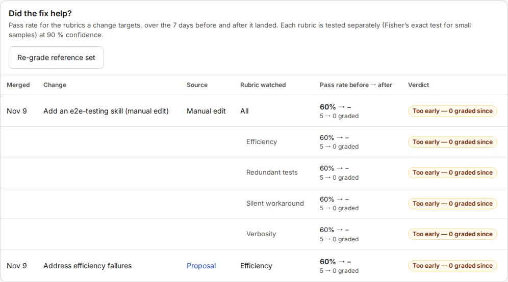

# How to extend the manual

This page is for people who change the manual or the screens it describes.

## Rules

- One topic per file.
  Name files `NN-topic.md` in lowercase with dashes.
  Screen pages start with `NN-screen-`.
- Add every new file to the table of contents in [README.md](README.md).
- Write each sentence on its own line.
- Quote button, field and heading names exactly as on the screen, in bold.
- Write procedures as numbered steps.
  One action per step, and the visible result after the step.
- Use the signal word **NOTICE** for data and privacy information.
  Introspect has no risk of injury, so do not use WARNING or DANGER.
- Use one term for one thing.
  Check the [glossary](19-glossary.md) before you invent a name.
- Describe only what the code does.
  If you change a screen, change its manual page in the same commit.
- Write images as ``.
  The alt text says what a reader should see, not "screenshot".

## Add a page

1. Create `docs/manual/NN-topic.md`.
2. Add a line for it to `README.md`.
3. Link to it from the pages that mention the topic.

## Add a screenshot

The screenshots come from `e2e/tests/manual-screenshots.spec.ts`.
It drives a seeded demo stack: a fake judge, a fake improver, 36 sample sessions and a fixed date.
It writes PNG files at 1280 × 860 pixels in the light theme.

1. Open `e2e/tests/manual-screenshots.spec.ts`.

   The file is one story with named steps (`test.step`): wizard, sessions, session detail, rubrics, proposals, trends, settings.

2. Put one `shot(...)` call at the point of the story where the screen looks right.

   ```ts
   await shot(page.getByRole('region', { name: 'Change log' }), 'trends-change-log');
   ```

   The first argument is the page for a full screenshot, or a locator for one element.
   Prefer a locator of a card or a panel: it stays stable when the layout around it changes.
   The second argument is the file name without `.png`, named by topic, for example `sessions-overview`.

3. Run `make manual-screenshots`.

   The command builds the demo stack, runs only this spec, copies the PNG files to `docs/manual/images/` and removes the stack.
   It takes about a minute.

4. Open the new PNG and check it.

   The picture is complete, not cropped and shows no "Loading" text.

5. Reference the image from the page.

   ```markdown
   
   ```

   The alt text is required.

6. Commit the PNG together with the spec and the manual page.

## Regenerate all screenshots

Run `make manual-screenshots` after a UI change.
The command replaces every file in `docs/manual/images/` that the spec writes.
Review the diff of the pictures before you commit.

The command needs only Docker.
It reuses the images of `make e2e`, so the second run is fast.
Its stack and its volume are removed at the end, also after a failure.

## Limits of the demo data

- The test judge fails every rubric for a session with three or more failed tool calls.
  The grades look uniform, and the Health check shows two warnings (**Judge (fake)** and **Clock**).
- All sample sessions are older than the fixed date, so the change log shows **Too early** verdicts.
  The manual shows no screenshot of an **Improved** verdict for this reason.
- The proposal text comes from the fake improver.
  A real proposal reads differently.

If you need other data, change the seed in `e2e/seed/seed.ts`.
That seed also feeds the E2E suite, so run `make e2e` afterwards.
